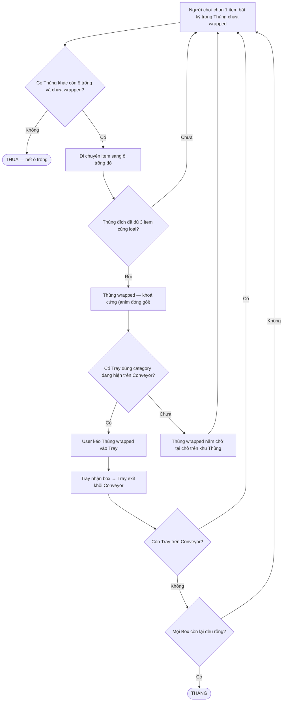

# Game Design Document: Goods Sort – Tray & Conveyor

**Phiên bản:** v0.4 — đồng bộ GDD với code prototype thực tế
**Trạng thái:** Bản nháp làm việc. Các mục gắn nhãn **[ĐỀ XUẤT]** cần chủ game duyệt. Các mục gắn nhãn **[GIẢ ĐỊNH — CẦN XÁC NHẬN]** là chỗ tài liệu này đang tự chọn 1 phương án để có thể tiến tới, nhưng chưa được designer chốt. Các mục gắn nhãn **[CHƯA IMPLEMENT]** mô tả thiết kế đã thảo luận nhưng code prototype chưa hiện thực.

## Changelog v0.3 → v0.4

- **[SỬA SAI]** Tray **chỉ có 1 slot** (nhận 1 Thùng wrapped → exit ngay), **không phải multi-slot** (3-5) như GDD v0.3 mô tả. Cập nhật toàn bộ Core Loop, Mục 4, điều kiện Thắng.
- **[SỬA SAI]** Conveyor **chỉ implement kiểu Oval** (Tray xoay liên tục trên ellipse). Kiểu One-way **chưa implement**. Bỏ nhánh One-way khỏi flowchart.
- **[SỬA SAI]** Mỗi Tray có thêm `targetItemId` — hiển thị emoji item cụ thể mà Tray muốn nhận (gợi ý thị giác). GDD cũ không đề cập.
- **[SỬA SAI]** Số Tray per level = **số item types (bộ 3 item)**, **không phải ≥ số category**. Mỗi Tray match 1 bộ 3 item cùng loại, không phải nhận nhiều box cùng category.
- **[SỬA SAI]** Solver BFS **bị skip** trong prototype (branching factor quá lớn, freeze UI). Level generate 1 lần, không verify solvability.
- **[LÀM RÕ]** Bến chờ (Loading Dock) **chưa implement** — Thùng wrapped nằm tại chỗ trên khu Thùng. Giữ lại như đề xuất tương lai.
- **[LÀM RÕ]** Điều kiện Thắng: tất cả Tray đã bị remove khỏi conveyor **VÀ** mọi Box còn lại trên bàn đều rỗng. Box khi drop vào Tray bị xóa khỏi mảng boxes.
- Đồng bộ toàn bộ bảng tham số (Mục 12) và câu hỏi mở (Mục 13) cho khớp code thực tế.

## Changelog v0.2 → v0.3

- **[XÁC NHẬN]** Thùng **cố định 3 ô**, không thay đổi theo level hay biến thể.
- **[XÁC NHẬN]** Luật đặt item: Thùng đích chỉ cần có ≥1 ô trống, **không bắt buộc cùng loại**. Bỏ hoàn toàn ràng buộc kiểu Water Sort. Cập nhật lại Core Loop, điều kiện Thua, và solver tương ứng.
- **[XÁC NHẬN]** Thùng hoàn thành (3 item cùng loại) → **wrapped** (animation đóng gói thùng hàng) → khoá cứng, không lấy item ra được. Chỉ có thể nhấc cả Thùng vào Tray.
- **[XÁC NHẬN]** Giao Thùng vào Tray: **user kéo thủ công** (drag), không tự động.
- **[XÁC NHẬN]** Input Lớp 1 (di chuyển item giữa Thùng): **tap-tap**. Tuy nhiên, nâng cấp lên **Grid mở** (Phương án B ở v0.3) — user có thể tap chọn BẤT KỲ item nào trong Thùng để lấy ra, không bắt buộc lấy từ trên xuống dưới.
- **[LÀM RÕ]** Quan hệ Tray — Item type: mỗi Tray match 1 item type cụ thể (xem Mục 4 v0.4).
- **[XÁC NHẬN]** Layer chìm: Chọn **Phương án B — Grid mở**, truy cập tất cả. Các item sẽ dồn xuống (collapse) khi có item ở giữa bị nhấc ra.
- Cập nhật toàn bộ mục Input & UX (mục 7).

## Changelog v0.1 → v0.2

- Sửa lại toàn bộ mô tả Thùng: đây là cơ chế **dồn/gom hàng kiểu Water Sort** (di chuyển từng item một giữa các Thùng nhiều ô, không swap), không phải "lấy 1 item bỏ thẳng vào Tray" như v0.1 hiểu nhầm.
- Bỏ đề xuất "vùng đệm chung" ở v0.1 (designer xác nhận không cần) — thay bằng đề xuất thu hẹp hơn: **Bến chờ** chỉ dành cho Thùng đã hoàn thành nhưng chưa có Tray phù hợp.
- Thêm hẳn 2 mục mới: **Input & UX** (mục 7) và **Thuật toán đảm bảo giải được** (mục 8), có prototype code + số liệu thực nghiệm đi kèm (xem file `thung_solvability_prototype.py`).
- Điều chỉnh lại đánh giá thị trường và rủi ro production của Layer chìm sau phản hồi của designer.
- Định nghĩa chính xác lại điều kiện Thua dựa trên việc formalize state model cho solver.

---

## 1. Tổng quan

| | |
|---|---|
| Thể loại | Casual/mid-core puzzle — consolidation + quản lý sản xuất-giao hàng (Tray/Conveyor) |
| Nền tảng đề xuất | Mobile (iOS/Android), giả định F2P |
| Đối tượng | Người chơi quen thể loại puzzle sort, tiếp cận dễ nhờ luật đặt item thoáng (không ràng buộc loại) |
| Cấu trúc phiên chơi | Theo level, mỗi level là 1 puzzle sinh bằng thuật toán (LevelGenerator) |

**Elevator pitch:** Dồn hàng cùng loại vào từng Thùng, giao Thùng đầy cho đúng Tray, đẩy băng chuyền trước khi hết chỗ xoay xở.

**USP (cập nhật v0.3):** Khác Water Sort ở chỗ **không ràng buộc loại khi đặt item** — người chơi có thể đặt bất kỳ item nào vào bất kỳ ô trống nào, tạo cảm giác tự do hơn nhưng cũng dễ "tự đẩy mình vào ngõ cụt" nếu không quy hoạch. Cơ chế lõi vẫn là bài toán dồn/gom (consolidation), cộng thêm lớp quản lý Tray/Conveyor phía trên tạo tầng quyết định thứ hai (ưu tiên category nào dựa theo Tray đang mở). Tổ hợp 2 tầng quyết định (vi mô: dồn hàng — vĩ mô: ưu tiên giao hàng) là điểm khác biệt so với cả dòng Water Sort thuần (có ràng buộc loại cứng, không có lớp giao hàng) lẫn dòng Goods Sort thuần (không có bài toán dồn hàng).

---

## 2. Core Loop



*"Ô trống hợp lệ" = Thùng đích chưa đầy (còn ≥1 ô trống) và chưa wrapped. **Không ràng buộc loại item** — bất kỳ item nào đều có thể đặt vào bất kỳ ô trống nào. [ĐÃ XÁC NHẬN v0.3, ĐÃ IMPLEMENT].*

**Mô tả bằng lời (khớp code `GameEngine.js`):**
1. Mỗi Thùng (Box) có **cố định 3 ô** (`maxSize = 3`), chứa sẵn hỗn hợp nhiều loại item ngay từ đầu level.
2. Người chơi tap chọn **bất kỳ item nào** trong Thùng (Grid mở — `selectSource(boxId, itemIndex)`), rồi tap Thùng đích. Thùng đích chỉ cần có ô trống và chưa wrapped (`canAccept()` = `items.length < maxSize && !isWrapped`). **Không ràng buộc loại.**
3. Item bị lấy ra bằng `splice(index, 1)` — các item phía sau dồn xuống tự động (collapse).
4. Thùng đủ 3 item cùng loại → `checkWrapped()` → **wrapped** → `isWrapped = true` → khoá cứng, không lấy item ra được.
5. User **kéo thủ công** (pointerdown → pointermove → pointerup) Thùng wrapped vào Tray đúng category trên Conveyor (`dropOnTray(trayId)`).
6. Tray nhận box → **Tray bị remove ngay** khỏi Conveyor (`conveyor.removeTray(trayId)`) → animation exit (Tray trượt theo ellipse đến cạnh trái rồi fade out). Box bị xóa khỏi mảng `this.boxes`.
7. **Thắng** khi `!conveyor.hasRemainingTrays()` VÀ `boxes.every(b => b.isEmpty())`.
8. **Thua** khi mọi Box chưa wrapped đều đầy 3 ô — không còn ô trống nào trên toàn bàn.

---

## 3. Hệ thống Thùng (Box / Consolidation Puzzle)

### 3.1 Cơ chế lõi (khớp `Box.js`)

Mỗi Thùng (class `Box`) có **cố định 3 ô** (`maxSize = 3`). Lúc bắt đầu level, Thùng chứa sẵn hỗn hợp item đa dạng loại — được `LevelGenerator` phân phối ngẫu nhiên từ item pool. Người chơi lấy **bất kỳ item nào** (theo index) trong Thùng, đặt sang ô trống của Thùng khác. **Không ràng buộc loại**: `canAccept()` chỉ kiểm tra `items.length < maxSize && !isWrapped`. Mục tiêu: mỗi Thùng cuối cùng chỉ chứa đúng 1 loại, đủ 3 item → wrapped.

**API chính:**
- `removeItem(index)` — lấy item tại vị trí bất kỳ, dùng `splice` → các item sau dồn xuống
- `push(itemId)` — đặt item vào cuối mảng (nếu `canAccept()` = true)
- `canAccept()` — `items.length < 3 && !isWrapped`
- `checkWrapped()` — kiểm tra `isFull() && items[0] === items[1] === items[2]` → set `isWrapped = true`

### 3.2 Grid mở (Phương án B) [ĐÃ CHỐT, ĐÃ IMPLEMENT]

Tất cả item trong Thùng đều nhìn thấy và truy cập được cùng lúc (render 3 slot, user tap vào slot bất kỳ). Khi nhấc 1 item ở giữa ra, `splice(index, 1)` tự động dồn mảng — không tạo lỗ hổng.

> **Lưu ý:** GDD v0.3 có mô tả 3 phương án (A: Stack, B: Grid mở, C: Pyramid). Code prototype **chỉ implement Phương án B**. Phương án A và C giữ lại làm tham khảo cho phiên bản sau.

### 3.2b Khu Thùng theo cột, có Thùng bị che [CHỐT 9/2026, ĐÃ IMPLEMENT]

Khu Thùng là **3 cột × 4 hàng = 12 ô hiển thị**. Thùng thứ 13 trở đi xếp chồng lên đỉnh cột và **bị che, khoá hoàn toàn**: không nhấc item ra, không thả item vào, không kéo sang Khay. Khi một Thùng được giao cho Khay, nó rời khỏi cột → cả cột tụt xuống → lộ thêm đúng 1 Thùng.

Toàn bộ nội dung, kể cả phần bị che, được chốt ngay lúc spawn (`layout.columns` trong output của bộ sinh màn), nên tính giải được vẫn chứng minh được trước.

Hai ràng buộc bắt buộc, do `assignLayout()` và `simulateWithLayout()` bảo đảm:

1. **Mọi Thùng còn ô trống phải nằm trong tầm với lúc spawn.** Cả bàn chỉ có 3 ô trống (bất biến `F = 3N − 3S`); giấu chúng đi là người chơi không có nước đi nào ngay từ đầu.
2. **Lời giải tham chiếu không được chạm vào Thùng đang bị che** — và phải đúng với *mọi* thứ tự giao hàng, không chỉ một. Người chơi tự chọn giao Thùng nào trước, thứ tự đó quyết định Khay nào biến mất trước, từ đó quyết định cột tụt xuống lúc nào. Bộ sinh màn chạy thử 4 chính sách giao hàng khác nhau và chỉ nhận bố cục nào đúng với cả 4.

Số Thùng bị che tăng theo độ khó: 0 ở chặng làm quen, 0→4 ở hard, 1→6 ở super hard.

> **Lưu ý:** mục 3.2 ("Grid mở") vẫn đúng ở phạm vi **item trong một Thùng** — cả 3 slot đều nhìn thấy và chạm được. Che khuất xảy ra ở cấp **Thùng**, không phải cấp item.

### 3.3 Biến thể khác [CHƯA IMPLEMENT — tham khảo]

**Phương án A — Stack tuyến tính (Top-down)**
- Chỉ item trên cùng truy cập được. Đơn giản nhất, solver dùng lại 100%.

**Phương án C — Che khuất có hướng (pyramid / cascade)**
- Item ở lớp trên che item lớp dưới. Chỉ item không bị che mới truy cập được. Cần model riêng cho solver.

### 3.4 Trạng thái hoàn thành và giao hàng [ĐÃ XÁC NHẬN, ĐÃ IMPLEMENT]

Thùng đủ 3 item cùng loại (`checkWrapped()` trả true) → **wrapped**: `isWrapped = true` → UI phát animation đóng gói thùng hàng (CSS: flap đóng + tape dán) → **khoá cứng** — `canAccept()` trả false, `removeItem()` trả null. Thùng wrapped chỉ có thể được **kéo toàn bộ vào Tray đúng category** (user thao tác drag, xem mục 7 Lớp 2).

**Chưa có Tray phù hợp?** Thùng wrapped **nằm tại chỗ** trên khu Thùng. Không có Bến chờ (Loading Dock) riêng — xem mục 3.5.

### 3.5 [ĐỀ XUẤT — CHƯA IMPLEMENT] Bến chờ (Loading Dock)

GDD v0.3 đề xuất khu chờ nhỏ cho Thùng wrapped chưa có Tray đúng category. **Code prototype chưa implement** — Thùng wrapped vẫn chiếm 1 vị trí trên khu Thùng (nhưng không chiếm "ô trống" vì isWrapped → không ảnh hưởng canAccept của box khác). Có thể để dành làm tính năng mở khoá sau.

### 3.6 Luật đặt item [ĐÃ XÁC NHẬN v0.3, ĐÃ IMPLEMENT]

**Thùng đích chỉ cần có ≥1 ô trống và chưa wrapped.** Không ràng buộc loại.

Code: `canAccept()` = `this.items.length < this.maxSize && !this.isWrapped`

Hệ quả thiết kế:
- Số nước đi hợp lệ tại mọi thời điểm **cao hơn nhiều** so với Water Sort → người chơi ít bị "kẹt cứng" hơn, nhưng cũng khó nhận ra nước đi hay/dở hơn.
- Điều kiện Thua **khó xảy ra hơn** (chỉ khi mọi Thùng chưa wrapped đều đầy, không còn ô trống nào) — game có xu hướng "dễ sống" nhưng vẫn có thể "khó thắng hiệu quả".

---

## 4. Hệ thống Tray [CẬP NHẬT v0.4 — sửa sai so với v0.3]

> **⚠️ SỬA SAI QUAN TRỌNG:** GDD v0.3 mô tả Tray có nhiều slot (3-5), nhận nhiều Thùng wrapped, đầy mới clear. Code thực tế: **Tray chỉ có 1 slot**, nhận 1 Thùng wrapped → bị remove ngay khỏi Conveyor.

### 4.1 Cấu trúc Tray (khớp `Tray.js`)

| | |
|---|---|
| Constructor | `Tray(id, categoryId, targetItemId)` |
| Slot | **1 slot duy nhất** (`this.slot = null`) |
| Matching | `canAccept(box)` = box.isWrapped **VÀ** box.getCategory() === this.categoryId **VÀ** this.slot === null |
| Nhận box | `receiveBox(box)` → set `this.slot = box` |
| Kiểm tra đầy | `isFull()` = `this.slot !== null` |

### 4.2 `targetItemId` — gợi ý thị giác

Mỗi Tray có `targetItemId` (ví dụ: `'bear'`, `'pizza'`). UI dùng giá trị này để hiển thị emoji item cụ thể trên Tray (`getItemEmoji(tray.targetItemId)`) — giúp user biết Tray này muốn nhận loại item nào. Matching logic vẫn dùng `categoryId`, không dùng `targetItemId`.

### 4.3 Luồng hoạt động

1. Tray hiện trên Conveyor với nhãn category + emoji item gợi ý.
2. User kéo Thùng wrapped vào Tray đúng category → `tray.receiveBox(box)`.
3. **Tray bị remove ngay** khỏi Conveyor (`conveyor.removeTray(trayId)`) — không chờ "đầy".
4. Box bị xóa khỏi mảng `this.boxes` (`this.boxes = this.boxes.filter(b => b.id !== box.id)`).
5. Animation: Tray trượt tiếp trên ellipse đến cạnh trái rồi fade out.

### 4.4 Quan hệ Tray — Item Type (khớp `LevelGenerator.js`)

- **Mỗi Tray match đúng 1 item type** (1 bộ 3 item cùng loại = 1 Thùng wrapped = 1 Tray).
- **Số Tray per level = số bộ item = `numFilledBoxes`** (số Thùng có item lúc đầu).
- Ví dụ: Level có 6 Thùng, 1 Thùng rỗng → 5 Thùng có item → cần 5 bộ item (mỗi bộ 3 cái) → 5 Tray.
- Tray được shuffle ngẫu nhiên trên Conveyor.

> **So sánh v0.3:** GDD cũ nói "Tray ≥ số category", "1 Tray nhận nhiều box cùng category". Code: 1 Tray = 1 box = 1 item type. Đây là thiết kế đơn giản hơn và rõ ràng hơn.

---

## 5. Hệ thống Conveyor [CẬP NHẬT v0.4 — sửa sai]

> **⚠️ SỬA SAI:** GDD v0.3 mô tả 2 kiểu Conveyor (Oval + One-way). Code **chỉ implement kiểu Oval**.

### 5.1 Kiểu Oval (khớp `Conveyor.js` + `TrayRenderer.js`) [ĐÃ IMPLEMENT]

Tray xoay liên tục trên **quỹ đạo ellipse** (oval conveyor belt). Cụ thể:

- **Ellipse:** tâm = giữa container, bán kính ngang `rx = (containerWidth - 90) / 2`, bán kính dọc `ry = 80`.
- **Tốc độ:** `deltaTheta = -0.015 * (dt / 16.66)` radian/frame → Tray di chuyển theo chiều kim đồng hồ.
- **Active window:** `maxActive = 4` Tray hiển thị cùng lúc. Tray được phân bố đều trên ellipse.
- **Z-index:** Tray ở nửa trước (sin ≤ 0) có z-index cao hơn nửa sau.
- **Port IN/OUT:** Hiển thị cổng IN (phải) và OUT (trái) trên belt, tuy nhiên Tray thực tế xoay liên tục, không "vào/ra" qua cổng.

**Khi Tray bị remove:**
1. Tray đánh dấu `isExiting = true`.
2. Tray tiếp tục di chuyển theo ellipse.
3. Khi gần cạnh trái (`cos(theta) < -0.90` và `sin(theta) < 0`) → CSS class `exiting` → fade out trong 300ms.
4. Sau fade out → remove DOM + gọi `onComplete` callback.

### 5.2 `rotateLeft()` / `rotateRight()`

Tồn tại trong `Conveyor.js` nhưng **không được gọi** trong prototype. Đây là API dự phòng cho cơ chế xoay thủ công (nếu cần).

### 5.3 Kiểu One-way [CHƯA IMPLEMENT]

GDD v0.3 mô tả hàng Tray xếp dọc, chỉ Tray đầu hàng mới nhận box, xong thì hàng dịch lên. **Code chưa implement.** Giữ lại làm biến thể mở rộng (lever độ khó thêm).

---

## 6. Điều kiện Thắng / Thua [CẬP NHẬT v0.4 — khớp `GameEngine.checkConditions()`]

**Thắng:**
```javascript
!this.conveyor.hasRemainingTrays() && this.boxes.every(b => b.isEmpty())
```
- Tất cả Tray đã nhận đủ hàng và bị remove khỏi Conveyor (Băng chuyền trống không).
- Mọi Thùng (Box) **còn lại** trên bàn đều trống rỗng. 
- *Lưu ý về số lượng:* Số lượng Tray sinh ra = Số lượng bộ 3 item. Do luật game luôn bắt buộc có ít nhất 1 Thùng rỗng ban đầu để thao tác, nên **Số lượng Thùng trên bàn > Số lượng Tray** (không bằng nhau).

**Thua:**
```javascript
const activeBoxes = this.boxes.filter(b => !b.isWrapped && !b.isEmpty());
const hasEmptySlots = activeBoxes.length === 0 || this.boxes.some(b => !b.isWrapped && !b.isFull());
if (!hasEmptySlots) → LOST
```
- Thua khi **Tất cả các thùng đều được lấp đầy và không còn khoảng trống để thao tác** (không còn bất kỳ ô trống nào trên toàn bàn).
- *Lưu ý về Deadlock (Không có Tray phù hợp):* Trong prototype hiện tại, các Tray chạy theo vòng Elip (Oval) và **xoay vòng liên tục không bao giờ biến mất** cho đến khi nhận được hàng. Do đó, người chơi sẽ không bao giờ bị thua vì "không có Tray thỏa mãn" (Tray luôn ở đó chờ).
- *Lưu ý về Không gian (Layers):* Prototype hiện tại là **bàn chơi 2D phẳng (Flat Grid)**, tất cả các Thùng đều hiện hữu và có thể tương tác. **KHÔNG CÓ** cơ chế "các thùng bị che khuất bên dưới" (như Mahjong). Mọi tính toán thắng/thua đều dựa trên tất cả các Thùng đang hiển thị.

> **Lưu ý thiết kế (giữ từ v0.3):** Vì không ràng buộc loại, điều kiện Thua **khó xảy ra** — gần như chỉ xảy ra khi bàn chơi không có hoặc quá ít ô trống. Challenge chính là "thắng hiệu quả" (ít nước đi). **Cần lever độ khó bổ sung** (thời gian, số nước đi — xem mục 9) để tạo áp lực.

**Luật cứng bắt buộc:** mọi level phải có ít nhất 1 Thùng rỗng (`numEmptyBoxes ≥ 1` trong `LevelGenerator`).

---

## 7. Input & UX [CẬP NHẬT v0.4 — khớp `UIManager.js`]

Cơ chế có 2 lớp thao tác tách biệt, input thiết kế theo từng lớp:

**Lớp 1 — di chuyển item giữa Thùng** (thao tác chính) [ĐÃ IMPLEMENT]:
- **Tap-tap** (`handleSlotTap`): tap item nguồn → item được highlight (`.selected`) → tap Thùng đích.
- Sau khi chọn nguồn, UI **highlight các Thùng còn ô trống** (`.valid-target`) — vì không ràng buộc loại, mọi Thùng chưa đầy và chưa wrapped đều là đích hợp lệ.
- Tap cùng Box → deselect. Tap Box khác khi đã chọn → nếu target hợp lệ thì di chuyển, nếu không thì deselect + select nguồn mới ngay (nếu tap vào item).
- Thùng đầy/wrapped: click không có hiệu lực.

**Lớp 2 — giao Thùng wrapped vào Tray** (thao tác phụ) [ĐÃ IMPLEMENT]:
- **Drag thủ công** (`handleDragStart` → `handleDragMove` → `handleDragEnd`):
  - `pointerdown` trên Box wrapped → tạo ghost element (clone visual của box).
  - `pointermove` → ghost di chuyển theo con trỏ. Hit test bằng `elementsFromPoint` để xác định Tray bên dưới.
  - Khi hover lên Tray: nếu match category → `.highlight-match` (glow xanh). Nếu sai category → `.highlight-reject` (glow đỏ).
  - `pointerup` trên Tray hợp lệ → ghost animation fly-to-tray (scale 0.5 + fade out trong 300ms) → `engine.dropOnTray(trayId)`.
  - `pointerup` ngoài Tray → ghost biến mất, drag cancel, box quay lại vị trí.

**Feedback theo tầng (leo thang độ "đã tay"):** di chuyển item (scale 1.1 nhanh 150ms) → Thùng wrapped + animation đóng gói (flap + tape CSS ~800ms) → kéo Thùng vào Tray (ghost fly animation 300ms) → Tray exit (ellipse slide + fade 300ms).

**[ĐỀ XUẤT — CHƯA IMPLEMENT] Undo có giới hạn** (VD 3 lần/level hoặc hồi qua ads): dù luật đặt item không ràng buộc loại (dễ hơn Water Sort), việc dồn sai vẫn tạo ngõ cụt mềm. Cũng là 1 monetization lever tự nhiên.

**Layout (khớp `index.html`):** ~65% màn hình (phía trên, `#boxes-area`) cho khu Thùng, ~35% (phía dưới, `#tray-area`) cho Tray/Conveyor.

---

## 8. Thuật toán đảm bảo giải được (Solvability) [CẬP NHẬT v0.4]

### 8.1 Solver hiện tại (khớp `Solver.js`)

Solver BFS tìm trạng thái thắng (mọi Box hoặc rỗng hoặc wrapped: 3 item cùng loại).

**Cấu trúc:**
- State = mảng các Box (mỗi Box = mảng item IDs).
- `generateNextStates()`: duyệt mọi Box nguồn × mọi item index × mọi Box đích → tạo state mới nếu target chưa full/wrapped.
- `isWinState()`: mọi Box hoặc rỗng hoặc đầy 3 item cùng loại.
- `hashState()`: sort các Box rồi join → dedup (coi hoán vị Box giống nhau là 1 state).
- `MAX_NODES = 10000`, `maxDepth = 25`.

### 8.2 Vấn đề — Solver bị skip trong prototype

**Code `LevelGenerator.js` line 17:** `while (!levelData && attempts < 1)` — chỉ chạy 1 lần, **không gọi Solver**.

**Lý do (comment trong code):** "With Open Grid, any configuration is theoretically solvable as long as there is 1 empty box. Solver BFS hits node limit due to massive branching factor, causing UI freeze."

**Hệ quả:**
- Level được generate 1 lần, gán `difficulty = { minMoves: 0 }` mà không verify.
- Giả định "có 1 Box rỗng → giải được" **chưa chứng minh chặt chẽ** — có thể đúng với Open Grid + no type restriction, nhưng cần formal proof hoặc thực nghiệm diện rộng.
- Không có dữ liệu `minMoves` thật → không thể gắn nhãn độ khó tự động.

### 8.3 Đề xuất lộ trình (cập nhật)

1. **Giữ nguyên luật cứng:** `numEmptyBoxes ≥ 1`.
2. **Nếu cần solver:** chuyển sang **Web Worker** để tránh freeze UI. Hoặc dùng iterative deepening DFS + pruning mạnh hơn.
3. **Level nhỏ/dễ** (early game): generate-then-verify khả thi nếu solver chạy background.
4. **Level lớn/khó** (late game): ưu tiên **xây ngược từ trạng thái thắng** (reverse generation).
5. **Gắn nhãn độ khó:** cần solver hoạt động — hiện tại chưa có.

---

## 9. Cấu trúc nội dung & Lộ trình độ khó [CẬP NHẬT v0.4 — khớp `UIManager.startNewLevel()`]

### 9.1 Progression (khớp code)

Level tăng dần theo `currentLevel`:
- **Số Thùng:** `Math.min(6 + Math.floor(level / 3), 10)` → bắt đầu 6, tối đa 10.
- **Số Thùng rỗng:** cố định 1 (hardcode `numEmptyBoxes: 1`).
- **Số category:** `Math.min(2 + Math.floor(level / 2), 4)` → bắt đầu 2, tối đa 4.
- **Số item type per category:** cố định 2 (`itemTypesPerCat: 2`).

### 9.2 Item Catalog (khớp `ItemCatalog.js`)

4 category, mỗi category có 3 item types:

| Category | ID | Màu | Item types |
|----------|-----|------|-----------|
| Thú nhồi bông | `stuffed_animals` | #FFB6C1 (Pink) | 🧸 Gấu, 🦆 Vịt, 🐰 Thỏ |
| Đồ ăn | `food` | #FFDAB9 (Peach) | 🍎 Táo, 🍕 Pizza, 🍩 Donut |
| Văn phòng phẩm | `stationery` | #ADD8E6 (Light Blue) | ✏️ Bút chì, 📎 Kẹp giấy, ✂️ Kéo |
| Thể thao | `sports` | #90EE90 (Light Green) | ⚽ Bóng đá, 🏀 Bóng rổ, 🎾 Tennis |

### 9.3 Lever độ khó bổ sung [CHƯA IMPLEMENT]

- Vì điều kiện Thua khó xảy ra (mục 6), **giới hạn nước đi/thời gian** là lever độ khó chính → chưa implement.
- Onboarding đơn giản hơn Water Sort — không cần dạy luật "cùng loại".
- Biến thể One-way Conveyor (mục 5.3) — lever độ khó bổ sung cho late game.

---

## 10. Meta Systems

Như v0.1, bổ sung: **Undo có giới hạn** (mục 7) như 1 booster/monetization lever cụ thể. [CHƯA IMPLEMENT]

---

## 11. Art & Audio Direction

### 11.1 Visual (khớp `style.css` + renderers)

- **Thùng (Box):** 3D box bằng CSS (top-face + front-face + flaps). 3 slot hiển thị emoji item.
- **Wrapped animation:** flap top/bottom đóng lại (`rotateX`) + tape xuất hiện (scale từ 0 → 1).
- **Tray:** nhãn category (text + màu nền theo category color), emoji item gợi ý.
- **Conveyor belt:** repeating gradient tạo hiệu ứng dải băng chuyền.
- **Drag ghost:** clone DOM của box wrapped, di chuyển theo con trỏ, z-index 1000.
- **Font:** Baloo 2 (Google Fonts).

### 11.2 Audio [CHƯA IMPLEMENT]

Chưa có sound effect hay nhạc nền.

---

## 12. Bảng tham số khởi điểm (cập nhật v0.4 — khớp code)

| Tham số | Giá trị trong code | Source file | Ghi chú |
|---|---|---|---|
| Số ô mỗi Thùng | **3 (cố định)** | `Box.js:8` `maxSize = 3` | Đã xác nhận |
| Luật đặt item | **Chỉ cần ô trống + chưa wrapped** | `Box.js:28-29` | Không ràng buộc loại |
| Số Thùng active/level | 6 → 10 (tăng theo level) | `UIManager.js:107` | `Math.min(6 + floor(level/3), 10)` |
| Số Thùng rỗng lúc bắt đầu | **1 (cố định)** | `UIManager.js:108` | Hardcode `numEmptyBoxes: 1` |
| Số category | 2 → 4 (tăng theo level) | `UIManager.js:109` | `Math.min(2 + floor(level/2), 4)` |
| Số item type per category | **2 (cố định)** | `UIManager.js:110` | Hardcode `itemTypesPerCat: 2` |
| Số Tray per level | = `numFilledBoxes` | `LevelGenerator.js:79-81` | 1 Tray per bộ 3 item |
| Số slot mỗi Tray | **1** | `Tray.js:6` `this.slot = null` | Nhận 1 box → exit |
| Conveyor maxActive | **4** | `Conveyor.js:2` `maxActive = 4` | 4 Tray hiện cùng lúc |
| Conveyor type | **Oval** | `LevelGenerator.js:110` | `conveyorType: 'oval'` |
| Solver MAX_NODES | 10000 | `Solver.js:16` | Failsafe |
| Solver maxDepth | 25 | `Solver.js:8` | BFS depth limit |
| Solver status | **SKIP** | `LevelGenerator.js:17` | Không gọi solver |

---

## 13. Câu hỏi mở cần chốt [CẬP NHẬT v0.4]

### Đã giải quyết ✅

1. ~~**Đặt item vào Thùng khác có bắt buộc cùng loại/trống hoàn toàn không?**~~ → **Không.** Chỉ cần ô trống + chưa wrapped. [Xác nhận v0.3, Implement v0.4]
2. ~~**Thùng hoàn thành nhưng chưa có Tray phù hợp — khoá cứng hay phá ra dùng lại được?**~~ → **Khoá cứng (wrapped).** Nằm tại chỗ chờ Tray. [Xác nhận v0.3, Implement v0.4]
3. ~~**Số ô mỗi Thùng?**~~ → **Cố định 3 ô.** [Xác nhận v0.3, Implement v0.4]
4. ~~**Input Lớp 1?**~~ → **Tap-tap.** Grid mở, chọn bất kỳ item nào. [Xác nhận v0.3, Implement v0.4]
5. ~~**Input Lớp 2?**~~ → **User kéo thủ công (drag).** [Xác nhận v0.3, Implement v0.4]
6. ~~**Tray có bao nhiêu slot?**~~ → **1 slot.** Nhận 1 box wrapped → exit ngay. [Quyết định bởi code v0.4]
7. ~~**Conveyor kiểu gì?**~~ → **Oval (ellipse xoay liên tục).** [Quyết định bởi code v0.4]
8. ~~**Bao nhiêu Tray per level?**~~ → **= numFilledBoxes (1 Tray per bộ 3 item).** [Quyết định bởi code v0.4]
9. ~~**Layer chìm: phương án nào?**~~ → **Phương án B — Grid mở.** [Xác nhận v0.3, Implement v0.4]
10. ~~**Mọi Thùng có bắt đầu hỗn hợp?**~~ → **Có.** LevelGenerator tạo pool item, shuffle, chia đều vào Thùng. [Implement v0.4]

### Còn mở ❓

11. Có giới hạn thời gian/số nước đi trong level không? (mục 9 — **quan trọng vì điều kiện Thua khó xảy ra**)
12. Bến chờ (Loading Dock) — có cần implement không? Nếu có, giới hạn bao nhiêu Thùng? (mục 3.5)
13. Khi user kéo Thùng wrapped vào sai Tray (khác category) — hiện tại bounce back không animation. Cần visual feedback rõ hơn? (mục 7)
14. Có cần kiểu Conveyor One-way cho late game không? (mục 5.3)
15. Solver — có cần activate lại (chạy trong Web Worker) để verify solvability và gắn nhãn độ khó? (mục 8)
16. Undo — implement bao nhiêu lần/level? Monetize qua ads? (mục 7, 10)
17. **Tray multi-slot (nhận nhiều box)** — có muốn thay đổi thiết kế Tray thành multi-slot (như GDD v0.3 từng mô tả) không? Hay giữ 1-slot như code hiện tại?

---

*Source code prototype: thư mục `src/` — `core/` (GameEngine, Box, Tray, Conveyor), `data/` (ItemCatalog), `generator/` (LevelGenerator, Solver), `ui/` (UIManager, BoxRenderer, TrayRenderer, ConveyorRenderer).*
