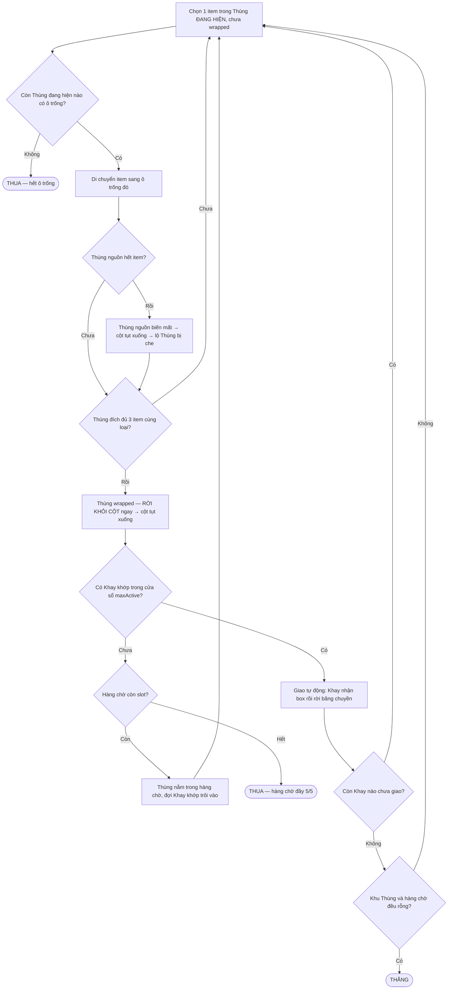

# Game Design Document: Goods Sort – Tray & Conveyor

**Phiên bản:** v0.5 — đồng bộ GDD với bộ sinh màn v2 (sinh ngược trên bố cục cột)
**Trạng thái:** Bản nháp làm việc. Các mục gắn nhãn **[ĐỀ XUẤT]** cần chủ game duyệt. Các mục gắn nhãn **[GIẢ ĐỊNH — CẦN XÁC NHẬN]** là chỗ tài liệu này đang tự chọn 1 phương án để có thể tiến tới, nhưng chưa được designer chốt. Các mục gắn nhãn **[CHƯA IMPLEMENT]** mô tả thiết kế đã thảo luận nhưng code prototype chưa hiện thực.

## Changelog v0.4 → v0.5

- **[SỬA SAI]** Thùng gói xong **KHÔNG nằm tại chỗ**. Nó rời khỏi cột ngay và rơi xuống **Hàng chờ 5 slot** (`GameEngine.moveBoxToQueue` + `QueueRenderer`). Mục 3.4/3.5 viết lại; "Bến chờ" từ [ĐỀ XUẤT] chuyển thành [ĐÃ IMPLEMENT].
- **[SỬA SAI]** **Hàng chờ đầy là THUA** — đây là điều kiện thua chính của game, không phải "hết ô trống". Mục 6 viết lại.
- **[SỬA SAI]** Bỏ luật "mỗi level phải có ≥1 Thùng rỗng". Luật hiện hành ngược lại: **lúc spawn KHÔNG Thùng nào được rỗng**, mọi Thùng có ≥1 vật. Không gian xoay xở đến từ `carrierBoxes`: tổng ô trống = `3 × carrierBoxes`.
- **[SỬA SAI]** `numEmptyBoxes` không còn tồn tại. Mục 12 cập nhật toàn bộ.
- **[SỬA SAI]** Số Thùng **không** còn chặn ở 10. Hard 52–68 Thùng, super hard 72–80, trong khi vùng nhìn thấy vẫn cố định 3×4 = 12 ô. Mục 9.1 viết lại.
- **[SỬA SAI]** Solver **không còn bị skip**. Tính giải được là bất biến cấu trúc của phép sinh ngược, và `par` là số nước **tối ưu chứng minh được**. Mục 8 viết lại.
- **[SỬA SAI]** `rotateLeft()`/`rotateRight()` đã bị **xoá khỏi `Conveyor.js`** (dead code, gây hiểu nhầm là người chơi với tới được mọi Khay). Mục 5.2 cập nhật.
- **[SỬA SAI]** `ITEM_CATALOG` nay là **8 nhóm × 4 loại = 32 loại item**, không phải 4×3. Mục 9.2 cập nhật.
- **[LÀM RÕ]** Giới hạn nước đi (`moveLimit`) **đã implement** và có hiệu lực. Undo vẫn chưa.
- **[LÀM RÕ]** Giao hàng là **tự động**: Thùng trong hàng chờ tự bay lên Khay khớp đầu tiên trong cửa sổ. Kéo tay chỉ là đường tắt.
- **[CHỐT]** Câu hỏi mở #1 (`trayMatchMode`) chốt theo hướng **chặt**: `Tray.canAccept()` luôn so `targetItemId`, chế độ `category` bị **bỏ hẳn** ở mọi tier. Khay hiện emoji nào thì chỉ nhận Thùng cùng emoji đó. Mục 4.4, 9.1, 9.3, 12 cập nhật.
- **[MỚI]** **Tutorial 6 bước cho level 1** (`src/ui/TutorialManager.js` + `#tutorial-overlay`): spotlight khoét lỗ, bàn tay chỉ, banner hướng dẫn, nút Skip, modal Trợ giúp (`#btn-help`) và modal "3 luật vàng" khi thắng. Mục 7 bổ sung.
- **[MỚI]** `tools/server.mjs` — server tĩnh cục bộ (`node tools/server.mjs`, cổng 8080) để mở bản ESM mà không cần Python.

## Changelog v0.3 → v0.4

- **[SỬA SAI]** Tray **chỉ có 1 slot** (nhận 1 Thùng wrapped → exit ngay), **không phải multi-slot** (3-5) như GDD v0.3 mô tả. Cập nhật toàn bộ Core Loop, Mục 4, điều kiện Thắng.
- **[SỬA SAI]** Conveyor **chỉ implement kiểu Oval** (Tray xoay liên tục trên ellipse). Kiểu One-way **chưa implement**. Bỏ nhánh One-way khỏi flowchart.
- **[SỬA SAI]** Mỗi Tray có thêm `targetItemId` — hiển thị emoji item cụ thể mà Tray muốn nhận (gợi ý thị giác). GDD cũ không đề cập.
- **[SỬA SAI]** Số Tray per level = **số item types (bộ 3 item)**, **không phải ≥ số category**. Mỗi Tray match 1 bộ 3 item cùng loại, không phải nhận nhiều box cùng category.
- **[SỬA SAI]** Solver BFS **bị skip** trong prototype (branching factor quá lớn, freeze UI). Level generate 1 lần, không verify solvability.
- **[LÀM RÕ]** Bến chờ (Loading Dock) **chưa implement** — Thùng wrapped nằm tại chỗ trên khu Thùng. Giữ lại như đề xuất tương lai.
- **[LÀM RÕ]** Điều kiện Thắng: tất cả Tray đã bị remove khỏi conveyor **VÀ** mọi Box còn lại trên bàn đều rỗng. Box khi drop vào Tray bị xóa khỏi mảng boxes.
- Đồng bộ toàn bộ bảng tham số (Mục 12) và câu hỏi mở (Mục 13) cho khớp code thực tế.

## Changelog v0.2 → v0.3

- **[XÁC NHẬN]** Thùng **cố định 3 ô**, không thay đổi theo level hay biến thể.
- **[XÁC NHẬN]** Luật đặt item: Thùng đích chỉ cần có ≥1 ô trống, **không bắt buộc cùng loại**. Bỏ hoàn toàn ràng buộc kiểu Water Sort. Cập nhật lại Core Loop, điều kiện Thua, và solver tương ứng.
- **[XÁC NHẬN]** Thùng hoàn thành (3 item cùng loại) → **wrapped** (animation đóng gói thùng hàng) → khoá cứng, không lấy item ra được. Chỉ có thể nhấc cả Thùng vào Tray.
- **[XÁC NHẬN]** Giao Thùng vào Tray: **user kéo thủ công** (drag), không tự động.
- **[XÁC NHẬN]** Input Lớp 1 (di chuyển item giữa Thùng): **tap-tap**. Tuy nhiên, nâng cấp lên **Grid mở** (Phương án B ở v0.3) — user có thể tap chọn BẤT KỲ item nào trong Thùng để lấy ra, không bắt buộc lấy từ trên xuống dưới.
- **[LÀM RÕ]** Quan hệ Tray — Item type: mỗi Tray match 1 item type cụ thể (xem Mục 4 v0.4).
- **[XÁC NHẬN]** Layer chìm: Chọn **Phương án B — Grid mở**, truy cập tất cả. Các item sẽ dồn xuống (collapse) khi có item ở giữa bị nhấc ra.
- Cập nhật toàn bộ mục Input & UX (mục 7).

## Changelog v0.1 → v0.2

- Sửa lại toàn bộ mô tả Thùng: đây là cơ chế **dồn/gom hàng kiểu Water Sort** (di chuyển từng item một giữa các Thùng nhiều ô, không swap), không phải "lấy 1 item bỏ thẳng vào Tray" như v0.1 hiểu nhầm.
- Bỏ đề xuất "vùng đệm chung" ở v0.1 (designer xác nhận không cần) — thay bằng đề xuất thu hẹp hơn: **Bến chờ** chỉ dành cho Thùng đã hoàn thành nhưng chưa có Tray phù hợp.
- Thêm hẳn 2 mục mới: **Input & UX** (mục 7) và **Thuật toán đảm bảo giải được** (mục 8), có prototype code + số liệu thực nghiệm đi kèm (xem file `thung_solvability_prototype.py`).
- Điều chỉnh lại đánh giá thị trường và rủi ro production của Layer chìm sau phản hồi của designer.
- Định nghĩa chính xác lại điều kiện Thua dựa trên việc formalize state model cho solver.

---

## 1. Tổng quan

| | |
|---|---|
| Thể loại | Casual/mid-core puzzle — consolidation + quản lý sản xuất-giao hàng (Tray/Conveyor) |
| Nền tảng đề xuất | Mobile (iOS/Android), giả định F2P |
| Đối tượng | Người chơi quen thể loại puzzle sort, tiếp cận dễ nhờ luật đặt item thoáng (không ràng buộc loại) |
| Cấu trúc phiên chơi | Theo level, mỗi level là 1 puzzle sinh bằng thuật toán, **đảm bảo giải được theo cấu trúc** (mục 8) |

**Elevator pitch:** Dồn hàng cùng loại vào từng Thùng, giao Thùng đầy cho đúng Khay — nhưng bạn chỉ nhìn thấy 12 Thùng dưới đáy một kho hàng cao 27 tầng, và thứ bạn cần luôn nằm ở tầng chưa lộ ra.

**USP (cập nhật v0.3):** Khác Water Sort ở chỗ **không ràng buộc loại khi đặt item** — người chơi có thể đặt bất kỳ item nào vào bất kỳ ô trống nào, tạo cảm giác tự do hơn nhưng cũng dễ "tự đẩy mình vào ngõ cụt" nếu không quy hoạch. Cơ chế lõi vẫn là bài toán dồn/gom (consolidation), cộng thêm lớp quản lý Tray/Conveyor phía trên tạo tầng quyết định thứ hai (ưu tiên category nào dựa theo Tray đang mở). Tổ hợp 2 tầng quyết định (vi mô: dồn hàng — vĩ mô: ưu tiên giao hàng) là điểm khác biệt so với cả dòng Water Sort thuần (có ràng buộc loại cứng, không có lớp giao hàng) lẫn dòng Goods Sort thuần (không có bài toán dồn hàng).

**USP thật sự (v0.5) — THÔNG TIN BỊ GIẤU.** Bàn chơi có tới 80 Thùng nhưng lúc nào cũng chỉ 12 Thùng chạm được; tài nguyên để hoàn thành phần lớn các bộ nằm trong Thùng **bị che phía trên**, chỉ lộ ra khi người chơi giao bớt hàng cho cột tụt xuống. Cộng với cửa sổ Khay hẹp và hàng chờ 5 slot, câu hỏi trung tâm không còn là "đặt item này ở đâu" mà là **"gói bộ nào TRƯỚC"** — sai thứ tự là kẹt vĩnh viễn dù bàn cờ trông vẫn còn thoáng.

---

## 2. Core Loop [CẬP NHẬT v0.5]



*"Ô trống hợp lệ" = Thùng đích **đang hiện**, chưa đầy, chưa wrapped. **Không ràng buộc loại item.***

**Mô tả bằng lời (khớp code `GameEngine.js`):**
1. Mỗi Thùng có **cố định 3 ô**, chứa sẵn hỗn hợp nhiều loại item ngay từ đầu level. Lúc spawn **không Thùng nào rỗng**.
2. Khu Thùng là **3 cột × 4 hàng nhìn thấy**; Thùng phía trên bị che và khoá hoàn toàn (mục 3.2b).
3. Người chơi tap chọn **bất kỳ item nào** trong một Thùng đang hiện, rồi tap Thùng đích đang hiện. `isAccessible()` chặn mọi thao tác lên Thùng bị che.
4. Thùng nguồn hết item → **biến mất** → cột tụt xuống → lộ thêm 1 Thùng.
5. Thùng đích đủ 3 item cùng loại → **wrapped** → **rời khỏi cột ngay** (cột lại tụt xuống) → rơi xuống **hàng chờ 5 slot**.
6. Hàng chờ **tự động** giao cho Khay khớp đầu tiên trong `maxActive` Khay đầu hàng đợi. Khay nhận box → rời băng chuyền (animation trượt theo ellipse rồi fade out).
7. **Thắng** khi mọi Khay đã giao, khu Thùng rỗng, hàng chờ rỗng.
8. **Thua** khi hàng chờ đầy (đường chính), hoặc hết ô trống, hoặc hết nước đi — xem mục 6.

---

## 3. Hệ thống Thùng (Box / Consolidation Puzzle)

### 3.1 Cơ chế lõi (khớp `Box.js`)

Mỗi Thùng (class `Box`) có **cố định 3 ô** (`maxSize = 3`). Lúc bắt đầu level, Thùng chứa sẵn hỗn hợp item đa dạng loại — được `LevelGenerator` phân phối ngẫu nhiên từ item pool. Người chơi lấy **bất kỳ item nào** (theo index) trong Thùng, đặt sang ô trống của Thùng khác. **Không ràng buộc loại**: `canAccept()` chỉ kiểm tra `items.length < maxSize && !isWrapped`. Mục tiêu: mỗi Thùng cuối cùng chỉ chứa đúng 1 loại, đủ 3 item → wrapped.

**API chính:**
- `removeItem(index)` — lấy item tại vị trí bất kỳ, dùng `splice` → các item sau dồn xuống
- `push(itemId)` — đặt item vào cuối mảng (nếu `canAccept()` = true)
- `canAccept()` — `items.length < 3 && !isWrapped`
- `checkWrapped()` — kiểm tra `isFull() && items[0] === items[1] === items[2]` → set `isWrapped = true`

### 3.2 Grid mở (Phương án B) [ĐÃ CHỐT, ĐÃ IMPLEMENT]

Tất cả item trong Thùng đều nhìn thấy và truy cập được cùng lúc (render 3 slot, user tap vào slot bất kỳ). Khi nhấc 1 item ở giữa ra, `splice(index, 1)` tự động dồn mảng — không tạo lỗ hổng.

> **Lưu ý:** GDD v0.3 có mô tả 3 phương án (A: Stack, B: Grid mở, C: Pyramid). Code prototype **chỉ implement Phương án B**. Phương án A và C giữ lại làm tham khảo cho phiên bản sau.

### 3.2b Khu Thùng theo cột, có Thùng bị che [CHỐT 9/2026, ĐÃ IMPLEMENT]

Khu Thùng là **3 cột × 4 hàng = 12 ô hiển thị** ở **mọi** tier. Thùng thứ 13 trở đi xếp chồng lên đỉnh cột và **bị che, khoá hoàn toàn**: không nhấc item ra, không thả item vào, không kéo sang Khay. Một chip `+N` trên đỉnh mỗi cột cho biết còn bao nhiêu Thùng bị che — **chỉ số lượng**, không lộ nội dung.

Một Thùng rời khỏi cột (được giao cho Khay **hoặc** hết item) → cả cột tụt xuống → lộ thêm đúng 1 Thùng.

Toàn bộ nội dung, kể cả phần bị che, được chốt ngay lúc spawn (`layout.columns` trong output của bộ sinh màn), nên tính giải được vẫn chứng minh được trước.

**Đây là đòn bẩy độ khó chính của game.** Số Thùng bị che:

| tier | Thùng cả bàn | bị che |
|---|---:|---:|
| tutorial (1–5) | 4–12 | 0 |
| onboarding (6–10) | 14–20 | 2–8 |
| acclimation (11–20) | 22–34 | 10–22 |
| normal | 34–46 | 22–34 |
| **hard** (25/35/45) | **52–68** | **40–56** |
| **super hard** (29/39/49) | **72–80** | **60–68** |

Vùng nhìn thấy ở đáy dày đặc item lẫn lộn của nhiều bộ khác nhau; thường chỉ **3–5 bộ** gom đủ 3 item ngay trong 12 ô đó. Item còn thiếu của các bộ khác nằm trong Thùng bị che phía trên — muốn lộ ra thì phải giao bớt hàng cho cột tụt xuống. Vòng lặp thật của người chơi: *gói được bộ nào trước → giao → cột tụt → lộ tài nguyên mới → gói tiếp bộ nào*. Sai thứ tự là kẹt.

Bộ sinh màn bảo đảm (xem `Algorithm.md` §2):

1. **Lời giải tham chiếu không bao giờ chạm vào Thùng đang bị che.** Đây là bất biến *cấu trúc* của phép sinh ngược, không phải kết quả của một bộ lọc — mỗi nước đi ngược chỉ được thao tác trên Thùng đang hiện, mà trạng thái ngược tại bước τ chính là trạng thái xuôi tại (T − τ).
2. **Vùng nhìn thấy lúc spawn luôn còn ô trống** để người chơi có nước đi ngay từ đầu.
3. `replayReal()` phát lại cả ván dưới **đúng** luật engine (cột, hàng chờ, cửa sổ Khay) trước khi màn được trả về.

> **Lưu ý:** mục 3.2 ("Grid mở") vẫn đúng ở phạm vi **item trong một Thùng** — cả 3 slot đều nhìn thấy và chạm được. Che khuất xảy ra ở cấp **Thùng**, không phải cấp item.

### 3.3 Biến thể khác [CHƯA IMPLEMENT — tham khảo]

**Phương án A — Stack tuyến tính (Top-down)**
- Chỉ item trên cùng truy cập được. Đơn giản nhất, solver dùng lại 100%.

**Phương án C — Che khuất có hướng (pyramid / cascade)**
- Item ở lớp trên che item lớp dưới. Chỉ item không bị che mới truy cập được. Cần model riêng cho solver.

### 3.4 Trạng thái hoàn thành và giao hàng [CẬP NHẬT v0.5]

Thùng đủ 3 item cùng loại (`checkWrapped()` trả true) → **wrapped**: UI phát animation đóng gói (flap đóng + tape dán) → **khoá cứng** — `canAccept()` trả false, `removeItem()` trả null.

Ngay sau đó Thùng **rời khỏi khu Thùng**:

1. `GameEngine.moveBoxToQueue()` gỡ nó khỏi cột ⇒ **cột tụt xuống, lộ Thùng kế tiếp**.
2. Nếu có Khay đang chạy nhận được ⇒ **giao luôn**, Khay rời băng chuyền.
3. Nếu không ⇒ Thùng rơi xuống **Hàng chờ** (mục 3.5) và nằm đó cho tới khi có Khay khớp trôi vào cửa sổ.

Giao hàng là **tự động** (`checkAndAutoFill` → `findQueueMatch`): người chơi không phải chọn Thùng nào ghép Khay nào. Kéo tay (mục 7 Lớp 2) chỉ là đường tắt cho Thùng đang nằm trong hàng chờ.

### 3.5 Hàng chờ (Loading Dock) [ĐÃ IMPLEMENT v0.5 — trước là ĐỀ XUẤT]

**5 slot** (`GameEngine.maxQueueSize = 5`, `QueueRenderer` vẽ dải slot dưới băng chuyền, có nhãn `n/5`).

- Chứa Thùng đã gói nhưng **chưa có Khay khớp** trong cửa sổ `conveyorMaxActive` Khay đầu hàng đợi.
- Mỗi lần một Khay rời băng chuyền, hàng chờ được quét lại và giao tiếp nếu khớp.
- **Slot thứ 6 = THUA** (`loseReason = 'Hàng chờ đã đầy (5/5 slots)!'`).

Đây là **ràng buộc lập kế hoạch trung tâm** của game: gói bừa theo thứ tự tiện tay sẽ làm đầy hàng chờ và thua, dù bàn cờ vẫn còn thừa ô trống. Nó cũng là lý do cửa sổ Khay hẹp lại làm màn khó hơn rất nhanh — đo trên bàn hard 60 Thùng (chính sách `planner`):

| cửa sổ Khay | 2 | 3 | 4 | 5 | 6 |
|---|---:|---:|---:|---:|---:|
| tỷ lệ thua | 77% | 77% | 57% | 23% | 20% |

### 3.6 Luật đặt item [ĐÃ XÁC NHẬN v0.3, ĐÃ IMPLEMENT]

**Thùng đích chỉ cần có ≥1 ô trống và chưa wrapped.** Không ràng buộc loại.

Code: `canAccept()` = `this.items.length < this.maxSize && !this.isWrapped`

Hệ quả thiết kế:
- Số nước đi hợp lệ tại mọi thời điểm **cao hơn nhiều** so với Water Sort → người chơi ít bị "kẹt cứng" hơn, nhưng cũng khó nhận ra nước đi hay/dở hơn.
- **[CẬP NHẬT v0.5]** Nhận định cũ "điều kiện Thua khó xảy ra" chỉ đúng khi bàn cờ phẳng và không có hàng chờ. Với luật hiện hành, thua chủ yếu đến từ **hàng chờ tràn** (mục 6) — gói bừa theo thứ tự tiện tay là chết, dù bàn còn thừa ô trống. Ngoài ra ô trống nay bị khoá chặt ở `3 × carrierBoxes` (6 ô ở hard) và phần lớn nằm trong vùng nhìn thấy, nên "hết ô trống" cũng không còn hiếm như trước.

---

## 4. Hệ thống Tray [CẬP NHẬT v0.4 — sửa sai so với v0.3]

> **⚠️ SỬA SAI QUAN TRỌNG:** GDD v0.3 mô tả Tray có nhiều slot (3-5), nhận nhiều Thùng wrapped, đầy mới clear. Code thực tế: **Tray chỉ có 1 slot**, nhận 1 Thùng wrapped → bị remove ngay khỏi Conveyor.

### 4.1 Cấu trúc Tray (khớp `Tray.js`)

| | |
|---|---|
| Constructor | `Tray(id, categoryId, targetItemId)` |
| Slot | **1 slot duy nhất** (`this.slot = null`) |
| Matching | `canAccept(box)` = box.isWrapped **VÀ** box.getCategory() === this.categoryId **VÀ** this.slot === null |
| Nhận box | `receiveBox(box)` → set `this.slot = box` |
| Kiểm tra đầy | `isFull()` = `this.slot !== null` |

### 4.2 `targetItemId` — gợi ý thị giác

Mỗi Tray có `targetItemId` (ví dụ: `'bear'`, `'pizza'`). UI dùng giá trị này để hiển thị emoji item cụ thể trên Tray (`getItemEmoji(tray.targetItemId)`) — giúp user biết Tray này muốn nhận loại item nào. Matching logic vẫn dùng `categoryId`, không dùng `targetItemId`.

### 4.3 Luồng hoạt động

1. Tray hiện trên Conveyor với nhãn category + emoji item gợi ý.
2. User kéo Thùng wrapped vào Tray đúng category → `tray.receiveBox(box)`.
3. **Tray bị remove ngay** khỏi Conveyor (`conveyor.removeTray(trayId)`) — không chờ "đầy".
4. Box bị xóa khỏi mảng `this.boxes` (`this.boxes = this.boxes.filter(b => b.id !== box.id)`).
5. Animation: Tray trượt tiếp trên ellipse đến cạnh trái rồi fade out.

### 4.4 Quan hệ Tray — Item Type [CẬP NHẬT v0.5]

- **Mỗi Tray match đúng 1 bộ 3 item** (1 bộ = 1 Thùng wrapped = 1 Tray).
- **Khớp theo `targetItemId`, ở mọi tier** [chốt 9/2026]. `Tray.canAccept()` = `box.getItemType() === this.targetItemId`. Chế độ `category` đã bị bỏ: Khay hiện emoji nào thì **chỉ** nhận Thùng cùng emoji đó, đúng như UI hứa hẹn.
- **Số Tray per level = `numSets` = `numBoxes − carrierBoxes`.**
  Ví dụ hard L45: 68 Thùng − 2 Thùng chuyển tiếp = **66 Tray**.
- **Thứ tự Tray KHÔNG ngẫu nhiên.** Nó bám theo thứ tự giao hàng của lời giải tham chiếu,
  và chỉ được hoán vị **trong từng khối kích thước ≤ `conveyorMaxActive`**. Lý do: cửa sổ
  Khay là một **tiền tố cố định**, nên một Tray bị đẩy ra ngoài cửa sổ so với thời điểm
  người chơi gói được Thùng của nó sẽ khiến Thùng đó nằm lì trong hàng chờ → tràn → thua.
  Khối lớn hơn cửa sổ là **bế tắc chắc chắn**, xem `Algorithm.md` §5.
- `matchMode` của Tray được chọn theo **nhóm hàng**, không theo từng Tray — xem
  `Algorithm.md` §5.1 để biết vì sao trộn hai chế độ trong cùng một nhóm gây bế tắc.

> **So sánh v0.3:** GDD cũ nói "Tray ≥ số category", "1 Tray nhận nhiều box cùng category". Code: 1 Tray = 1 box = 1 bộ item.

---

## 5. Hệ thống Conveyor [CẬP NHẬT v0.4 — sửa sai]

> **⚠️ SỬA SAI:** GDD v0.3 mô tả 2 kiểu Conveyor (Oval + One-way). Code **chỉ implement kiểu Oval**.

### 5.1 Kiểu Oval (khớp `Conveyor.js` + `TrayRenderer.js`) [ĐÃ IMPLEMENT]

Tray xoay liên tục trên **quỹ đạo ellipse** (oval conveyor belt). Cụ thể:

- **Ellipse:** tâm = giữa container, bán kính ngang `rx = (containerWidth - 90) / 2`, bán kính dọc `ry = 80`.
- **Tốc độ:** `deltaTheta = -0.015 * (dt / 16.66)` radian/frame → Tray di chuyển theo chiều kim đồng hồ.
- **Active window:** `maxActive` Tray hiển thị cùng lúc, **do bộ sinh màn quyết định** (`level.conveyor.maxActive`, 3–5 tuỳ tier), không còn hardcode 4. Tray được phân bố đều trên ellipse.
- **Z-index:** Tray ở nửa trước (sin ≤ 0) có z-index cao hơn nửa sau.
- **Port IN/OUT:** Hiển thị cổng IN (phải) và OUT (trái) trên belt, tuy nhiên Tray thực tế xoay liên tục, không "vào/ra" qua cổng.

**Khi Tray bị remove:**
1. Tray đánh dấu `isExiting = true`.
2. Tray tiếp tục di chuyển theo ellipse.
3. Khi gần cạnh trái (`cos(theta) < -0.90` và `sin(theta) < 0`) → CSS class `exiting` → fade out trong 300ms.
4. Sau fade out → remove DOM + gọi `onComplete` callback.

### 5.2 Cửa sổ Khay là TIỀN TỐ CỐ ĐỊNH [CẬP NHẬT v0.5]

`getAllActiveTrays()` ≡ `allTrays.slice(0, maxActive)`. Người chơi **chỉ** với tới `maxActive` Khay đầu hàng đợi; Khay kế tiếp chỉ trôi vào khi một Khay phía trước được giao xong.

`rotateLeft()` / `rotateRight()` từng tồn tại trong `Conveyor.js` nhưng **chưa bao giờ được gọi** — đã **xoá** (9/2026). Chúng gây hiểu nhầm nghiêm trọng: đọc code thì tưởng người chơi tiếp cận được mọi Khay, thực tế thì không, và toàn bộ mô hình độ khó dựa trên giả định tiền tố cố định.

> Nếu muốn cho người chơi thấy trước hàng đợi, hãy làm một khu **"sắp tới" CHỈ ĐỂ XEM** thay vì cho xoay cửa sổ — nó không động tới mô hình độ khó.

### 5.3 Kiểu One-way [CHƯA IMPLEMENT]

GDD v0.3 mô tả hàng Tray xếp dọc, chỉ Tray đầu hàng mới nhận box, xong thì hàng dịch lên. **Code chưa implement.** Giữ lại làm biến thể mở rộng (lever độ khó thêm).

---

## 6. Điều kiện Thắng / Thua [CẬP NHẬT v0.5 — khớp `GameEngine.checkConditions()`]

**Thắng:**
```javascript
!this.conveyor.hasRemainingTrays() &&
(this.boxes.length === 0 || this.boxes.every(b => b.isEmpty())) &&
this.queue.length === 0
```
Mọi Khay đã nhận hàng và rời băng chuyền, khu Thùng rỗng, **và hàng chờ rỗng**.

**Thua — ba đường, theo thứ tự hay gặp:**

1. **Hàng chờ tràn.** Gói Thùng thứ 6 mà chưa có Khay khớp cho 5 Thùng đang chờ →
   `'Hàng chờ đã đầy (5/5 slots)!'`. **Đây là đường thua chính** và là ràng buộc lập kế
   hoạch trung tâm của game: bàn cờ vẫn còn ô trống, vẫn còn nước đi, nhưng người chơi đã
   gói sai thứ tự so với hàng đợi Khay.
2. **Hết ô trống.** Không Thùng nào trong tầm với còn chỗ, và không có Thùng nào giao được
   → `'Không còn ô trống để hoán đổi đồ vật.'` Cả bàn chỉ có `3 × carrierBoxes` ô trống
   (6 ô ở tier hard), phần lớn nằm trong vùng nhìn thấy, nên đường này có thật.
3. **Hết nước đi.** `moveCount >= moveLimit` **và** không còn Thùng nào giao được ngay →
   `'Out of moves — the limit is N.'` `moveLimit = ceil(par × slack)` với `par` là số nước
   **tối ưu chứng minh được**; dư địa 2.20× ở tutorial siết dần xuống 1.23× ở super hard.

> Lưu ý: `moveCount` chỉ đếm nước **chuyển item**, không đếm lượt giao Khay — đúng nghĩa
> par của bộ giải.

**Luật cứng bắt buộc [ĐỔI ở v0.5]:** lúc spawn **KHÔNG Thùng nào được rỗng** — mọi Thùng
phải có ≥1 vật. (Luật cũ "phải có ≥1 Thùng rỗng" đã bị bỏ.) Không gian xoay xở đến từ
`carrierBoxes`: tổng ô trống = `3 × carrierBoxes`, và con số này **không** loãng ra khi
bàn to lên — xem `Algorithm.md` §3.

> **Ghi chú lịch sử:** GDD v0.4 viết "người chơi không bao giờ thua vì không có Tray thoả
> mãn (Tray luôn ở đó chờ)" và "bàn chơi 2D phẳng, KHÔNG CÓ cơ chế thùng bị che". Cả hai
> câu đều **sai với luật hiện hành**: cửa sổ Khay là tiền tố cố định (mục 5.2) và khu Thùng
> có tới 68 Thùng bị che (mục 3.2b).

---

## 7. Input & UX [CẬP NHẬT v0.5 — khớp `UIManager.js`]

Cơ chế có 2 lớp thao tác tách biệt, input thiết kế theo từng lớp:

**Lớp 1 — di chuyển item giữa Thùng** (thao tác chính) [ĐÃ IMPLEMENT]:
- **Tap-tap** (`handleSlotTap`): tap item nguồn → item được highlight (`.selected`) → tap Thùng đích.
- Sau khi chọn nguồn, UI **highlight các Thùng còn ô trống** (`.valid-target`) — vì không ràng buộc loại, mọi Thùng chưa đầy và chưa wrapped đều là đích hợp lệ.
- Tap cùng Box → deselect. Tap Box khác khi đã chọn → nếu target hợp lệ thì di chuyển, nếu không thì deselect + select nguồn mới ngay (nếu tap vào item).
- Thùng đầy/wrapped: click không có hiệu lực.
- **Thùng bị che không vào DOM.** `BoxRenderer` chỉ vẽ Thùng trong tầm với, nên không có phần tử nào để chạm nhầm; `GameEngine.isAccessible()` là lớp chặn thứ hai ở phía engine. Đỉnh mỗi cột hiển thị chip `+N` cho biết còn bao nhiêu Thùng bị che (**chỉ số lượng**, không lộ nội dung).

**Lớp 2 — giao Thùng wrapped vào Tray** (thao tác phụ, **thường không cần dùng**) [ĐÃ IMPLEMENT]:

> Từ v0.5, Thùng gói xong tự bay xuống **hàng chờ** và tự giao khi có Khay khớp
> (`checkAndAutoFill`). Kéo tay chỉ còn là đường tắt; người chơi bình thường có thể chơi
> hết ván mà không kéo lần nào.
- **Drag thủ công** (`handleDragStart` → `handleDragMove` → `handleDragEnd`):
  - `pointerdown` trên Box wrapped → tạo ghost element (clone visual của box).
  - `pointermove` → ghost di chuyển theo con trỏ. Hit test bằng `elementsFromPoint` để xác định Tray bên dưới.
  - Khi hover lên Tray: nếu match category → `.highlight-match` (glow xanh). Nếu sai category → `.highlight-reject` (glow đỏ).
  - `pointerup` trên Tray hợp lệ → ghost animation fly-to-tray (scale 0.5 + fade out trong 300ms) → `engine.dropOnTray(trayId)`.
  - `pointerup` ngoài Tray → ghost biến mất, drag cancel, box quay lại vị trí.

**Feedback theo tầng (leo thang độ "đã tay"):** di chuyển item (scale 1.1 nhanh 150ms) → Thùng wrapped + animation đóng gói (flap + tape CSS ~550ms) → Thùng bay xuống hàng chờ (`QueueRenderer.animateBoxToQueue`) → cột tụt xuống (FLIP animation 260ms, `_chayFlip`) → Thùng bay từ hàng chờ lên Khay → Khay exit (ellipse slide + fade 300ms).

**HUD:** số nước đi hiển thị dạng `n / limit`, chuyển đỏ khi còn ≤5 nước. Hàng chờ hiển thị `n/5`.

**[ĐỀ XUẤT — CHƯA IMPLEMENT] Undo có giới hạn** (VD 3 lần/level hoặc hồi qua ads): dù luật đặt item không ràng buộc loại (dễ hơn Water Sort), việc dồn sai vẫn tạo ngõ cụt mềm. Cũng là 1 monetization lever tự nhiên.

**Tutorial level 1 [MOI 9/2026, DA IMPLEMENT]** (`src/ui/TutorialManager.js`):

- Chay tu dong khi vao level 1, 6 buoc dan dat + 1 man tong ket:
  `PICK` -> `PLACE` (gom bo dau tien) -> `QUEUE_EXPLAIN` (xem Thung goi xong bay xuong hang
  cho roi len Khay) -> lap lai voi bo thu hai -> `COMPLETE` (3 luat vang).
- Ky thuat: lop phu toi (`#tutorial-overlay`) co **spotlight khoet lo** dung o phan tu can
  cham, ban tay chi (`#tutorial-hand`), banner huong dan (`#tutorial-banner`), va vien
  highlight muc tieu. Moi thao tac ngoai vung spotlight bi chan.
- Nut **Skip** bo qua tutorial; nut **?** tren header (`#btn-help`) mo lai modal huong dan
  bat cu luc nao.

**Layout (khớp `index.html`):** ~65% màn hình (phía trên, `#boxes-area`) cho khu Thùng, ~35% (phía dưới, `#tray-area`) cho Khay/băng chuyền + hàng chờ.

Chiều cao một Thùng **không cố định**: `BoxRenderer._fitBoxHeight()` đo chiều cao thật còn lại rồi co `--box-h` (sàn 44px = vùng chạm tối thiểu), có `ResizeObserver` bám theo xoay màn hình và thanh địa chỉ trình duyệt. Trước v0.5 chiều cao cứng 75px làm cột 4 hàng cao ~400px trong khung ~330px — **hàng trên cùng bị cắt**, người chơi không nhìn thấy Thùng mà engine nói là đang hiện.

---

## 8. Thuật toán đảm bảo giải được (Solvability) [VIẾT LẠI v0.5]

> Chi tiết đầy đủ: [`02_THUAT_TOAN_SOLVABLE.md`](02_THUAT_TOAN_SOLVABLE.md) (nguyên lý) và
> [`Algorithm.md`](Algorithm.md) (mã giả, tham số, công thức).

### 8.1 Vấn đề của cách cũ

GDD v0.4 mô tả solver BFS **bị skip** vì branching factor quá lớn, và level được sinh
1 lần không verify. Giả định "có 1 Box rỗng ⇒ giải được" chưa bao giờ được chứng minh.
Đo lại (TEST 5): sinh xuôi kiểu cũ cho level 6 Thùng thì **23.5%** số màn đã có sẵn một
Thùng wrapped ngay lúc bắt đầu — thùng miễn phí, hỏng hoàn toàn đường cong độ khó.

### 8.2 Cách hiện hành — sinh ngược trên bố cục cột [ĐÃ IMPLEMENT]

Không đi tìm lời giải nữa mà **đảo chiều bài toán**: bắt đầu từ trạng thái THẮNG (cột
rỗng, không còn Khay) rồi đi các nước **ngược**; trạng thái xuất phát của người chơi chính
là kết quả cuối, và lời giải xuôi là đúng dãy đó đảo chiều.

Ba phép ngược là nghịch đảo đúng ba sự kiện của `GameEngine`:

| | phép ngược | sự kiện xuôi |
|---|---|---|
| R1 | tạo Thùng 3-cùng-loại, **chèn** vào cột, thêm 1 Khay vào đầu hàng đợi | Thùng gói xong → rời cột → hàng chờ → giao Khay |
| R2 | rút 1 item từ Thùng này bỏ sang Thùng khác (cả hai **đang hiện**) | người chơi kéo 1 item |
| R3 | tạo Thùng **chỉ 1 item** rồi chèn vào cột | người chơi kéo nốt item cuối → Thùng rỗng biến mất → cột tụt |

Bất biến then chốt: *trạng thái ngược tại bước τ == trạng thái xuôi tại (T − τ)*. Nên chỉ
cần mọi nước ngược chỉ chạm Thùng **đang hiện** là khi phát lại xuôi mọi nước đều hợp lệ.
**Tính giải được VÀ tính chơi được đều là bất biến cấu trúc**, chi phí `O(K)` — sinh một
màn 80 Thùng tốn ~1–15 ms.

Hai hệ quả định lượng:

- **Tổng ô trống = `3 × carrierBoxes`, không phụ thuộc số Thùng.** Phóng to bàn không làm
  dễ hơn cũng không làm khó hơn, chỉ làm dài hơn.
- **`par` = số nước tối ưu, chứng minh được** ở mọi kích cỡ bàn (mỗi item lạc phải được
  kéo về ít nhất 1 lần, và lời giải tham chiếu làm đúng ngần ấy nước). Nhờ vậy
  `moveLimit = ceil(par × slack)` mới có nghĩa. Solver đầy đủ xác nhận 60/60 trên bàn nhỏ.

### 8.3 Ba lớp kiểm chứng

1. `replayReal()` trong chính bộ sinh — phát lại lời giải dưới đầy đủ luật (cột, hàng chờ
   5 slot, cửa sổ Khay). Sai một luật là bỏ màn, sinh lại.
2. `tools/selftest.js` — 8 test, gồm TEST 7 chơi hết ván qua `GameEngine` **thật**.
3. `tools/verify_build.html` — chạy cùng bộ kiểm tra đó trong trình duyệt trên `bundle.js`.

### 8.4 Đo độ khó — `GameSim.js`

Thước đo là **tỷ lệ thua của người chơi mô phỏng**, không phải số nước đi. Chính sách
`planner` nhìn cửa sổ Khay và slot hàng chờ (hai thứ hiện trên màn hình), không bao giờ
phạm lỗi hiển nhiên, nhưng **không** nhìn được Thùng bị che và **không** tìm kiếm. Ván nào
nó vẫn thua là ván đòi hỏi lập kế hoạch thật.

---

## 9. Cấu trúc nội dung & Lộ trình độ khó [VIẾT LẠI v0.5 — khớp `configForLevelNumber()`]

### 9.1 Progression

Nguồn sự thật **duy nhất** là `configForLevelNumber(L)` trong `SolvableLevelGenerator.js`.
UI chỉ truyền `levelNumber` — không còn tự tính tham số riêng như v0.4.

Định tuyến tier: `L ≤ 5` tutorial · `L ≤ 10` onboarding · `L ≤ 20` acclimation ·
`L % 10 == 9` **super hard** · `L % 10 == 5` **hard** · còn lại normal.

| tier | Lv | Thùng | bị che | ô trống (`3E`) | cửa sổ Khay | pool item | par | thua (`planner`) |
|---|---|---:|---:|---:|---:|---:|---:|---:|
| tutorial | 1–5 | 4–12 | 0 | 6–9 | 5 \* | 1–2 × 2 | 2–10 | 0% |
| onboarding | 6–10 | 14–20 | 2–8 | 9 | 5→4 | 2–3 × 2 | 12–20 | 0–10% |
| acclimation | 11–20 | 22–34 | 10–22 | 9 | 4 | 3×2 → 4×3 | 23–41 | 0–23% |
| normal | 21–49 | 34–46 | 22–34 | 6 | 4 | 4 × 3 | 42–62 | 13–57% |
| **hard** | 25/35/45 | **52–68** | **40–56** | 6 | 4 | 5 × 3 | 68–94 | **70%** |
| **super hard** | 29/39/49 | **72–80** | **60–68** | 9 | 3 | 6 × 3 | 97–112 | **93%** |

**Mọi Khay ở mọi tier đều khớp đúng loại item** (mục 4.4), nên "Khay đúng loại" không còn
là biến số của lộ trình.

> ⚠️ **Ba tier đầu đang lệch khỏi dải mục tiêu** (onboarding muốn 0–5%, acclimation 0–18%,
> normal 12–42%). Nguyên nhân: thay đổi 9/2026 bắt mọi Khay khớp đúng loại làm các tier
> thấp khó hơn hẳn, trong khi `LEVEL_SEEDS` vẫn là bộ seed tuyển dưới luật cũ. Sửa bằng
> cách chạy lại `node tools/curate50.mjs` — xem `level_generation_analysis.md` §3.

`columns = 3`, `visibleRows = 4` ở **mọi** tier — vùng nhìn thấy luôn là 12 ô.
\* Cửa sổ Khay bị kẹp về `min(giá trị cấu hình, numSets)`, nên L1–L2 thực tế chỉ có 2–3 Khay.

Bảng đầy đủ từng màn: [`50_level_design_report.md`](50_level_design_report.md).

Seed của 50 màn đã được **tuyển chọn** (`tools/curate50.mjs` → `LEVEL_SEEDS`), không sinh
ngẫu nhiên lúc chạy: cùng một khung hard, 16 seed khác nhau cho tỷ lệ thua từ 25% đến 85%.

### 9.2 Item Catalog (khớp `ItemCatalog.js`) [CẬP NHẬT v0.5]

**8 nhóm hàng × 4 loại = 32 loại item** (v0.4 ghi 4 × 3 = 12, đã lỗi thời):

| Nhóm hàng | ID | Item types |
|---|---|---|
| Thú nhồi bông | `stuffed_animals` | 🧸 Gấu · 🦆 Vịt · 🐰 Thỏ · 🐧 Chim cánh cụt |
| Đồ ăn | `food` | 🍎 Táo · 🍕 Pizza · 🍩 Donut · 🍔 Burger |
| Văn phòng phẩm | `stationery` | ✏️ Bút chì · 📎 Kẹp giấy · ✂️ Kéo · 📐 Thước |
| Thể thao | `sports` | ⚽ Bóng đá · 🏀 Bóng rổ · 🎾 Tennis · 🏐 Bóng chuyền |
| Dụng cụ | `tools` | 🔨 Búa · 🔧 Cờ lê · 🔩 Bu lông · ⚙️ Bánh răng |
| Nhạc cụ | `music` | 🎸 Guitar · 🎺 Kèn · 🥁 Trống · 🎹 Piano |
| Nhà bếp | `kitchen` | 🍳 Chảo · 🍴 Dao dĩa · ☕ Cốc · 🔪 Dao |
| Làm vườn | `garden` | 🌵 Xương rồng · 🌻 Hướng dương · 🍄 Nấm · 🌲 Thông |

Tier hard dùng 5 nhóm × 3 loại (15 loại), super hard 6 × 3 (18 loại) — đủ nhiều để **màu
sắc không còn giúp phân loại**, người chơi phải đọc từng emoji.

### 9.3 Lever độ khó — trạng thái implement

| Lever | Trạng thái | Ghi chú |
|---|---|---|
| Số Thùng bị che | ✅ ĐÃ IMPLEMENT | **đòn bẩy chính**, trọng số 0.22 trong điểm độ khó |
| Cửa sổ Khay (`conveyorMaxActive`) | ✅ ĐÃ IMPLEMENT | đòn bẩy mạnh thứ hai, 0.16 |
| Ô trống (`carrierBoxes`) | ✅ ĐÃ IMPLEMENT | 0.12 |
| Khay đòi đúng loại item | ✅ ĐÃ IMPLEMENT | **luôn bật ở mọi tier**, không còn là núm vặn |
| Giới hạn nước đi (`moveLimit`) | ✅ ĐÃ IMPLEMENT | có hiển thị `n / limit` trên HUD |
| Giới hạn thời gian (`timeToPlay`) | ❌ CHƯA | bộ sinh có phát ra giá trị, engine không dùng |
| Undo (`undoCount`) | ❌ CHƯA | bộ sinh có phát ra giá trị, engine không dùng |
| Conveyor One-way (mục 5.3) | ❌ CHƯA | biến thể mở rộng |

> Vì `timeToPlay` và `undoCount` chưa được cài đặt, chúng **không** được tính vào điểm độ
> khó — chấm điểm cho một luật không tồn tại là tự nói dối.

---

## 10. Meta Systems

Như v0.1, bổ sung: **Undo có giới hạn** (mục 7) như 1 booster/monetization lever cụ thể. [CHƯA IMPLEMENT]

---

## 11. Art & Audio Direction

### 11.1 Visual (khớp `style.css` + renderers)

- **Thùng (Box):** 3D box bằng CSS (top-face + front-face + flaps). 3 slot hiển thị emoji item.
- **Wrapped animation:** flap top/bottom đóng lại (`rotateX`) + tape xuất hiện (scale từ 0 → 1).
- **Tray:** nhãn category (text + màu nền theo category color), emoji item gợi ý.
- **Conveyor belt:** repeating gradient tạo hiệu ứng dải băng chuyền.
- **Drag ghost:** clone DOM của box wrapped, di chuyển theo con trỏ, z-index 1000.
- **Font:** Baloo 2 (Google Fonts).
- **Khu Thùng theo cột [v0.5]:** 3 cột dựng đứng, Thùng mới lộ ra trượt xuống bằng FLIP animation 260ms (`UIManager._chayFlip`); Thùng hết item co lại rồi biến mất (`.disappearing`, 200ms). Chip `+N` bo tròn trên đỉnh cột đếm số Thùng còn bị che.
- **Hàng chờ [v0.5]:** dải 5 slot dưới băng chuyền (`QueueRenderer`), nhãn `n/5`. Thùng gói xong bay từ khu Thùng xuống slot, rồi bay từ slot lên Khay.
- **Chiều cao Thùng co giãn [v0.5]:** `--box-h` được tính theo chiều cao thật của khu Thùng (sàn 44px), emoji trong slot co theo — xem mục 7.

### 11.2 Audio [CHƯA IMPLEMENT]

Chưa có sound effect hay nhạc nền.

---

## 12. Bảng tham số khởi điểm (cập nhật v0.5 — khớp code)

| Tham số | Giá trị trong code | Source | Ghi chú |
|---|---|---|---|
| Số ô mỗi Thùng | **3 (cố định)** | `Box.js` `maxSize = 3` | Đã xác nhận |
| Luật đặt item | **Chỉ cần ô trống + chưa wrapped** | `Box.canAccept()` | Không ràng buộc loại |
| Khu Thùng | **3 cột × 4 hàng hiển thị** | `configForLevelNumber` | `columns`/`visibleRows`, mọi tier |
| Số Thùng / level | **4 → 80** theo tier | `configForLevelNumber` | hard 52–68, super hard 72–80 |
| Thùng rỗng lúc bắt đầu | **0 (luật cứng)** | `buildDeep` bước 5 | mọi Thùng có ≥1 vật |
| Tổng ô trống | **`3 × carrierBoxes`** = 6 hoặc 9 | bất biến của phép sinh | không đổi theo số Thùng |
| Số nhóm hàng / level | 1 → 6 theo tier | `configForLevelNumber` | catalog có 8 |
| Loại item / nhóm | 2 → 3 theo tier | `configForLevelNumber` | catalog có 4 |
| Số Tray / level | **= `numSets` = `numBoxes − carrierBoxes`** | `finalize()` | hard L45: 66 Tray |
| Thứ tự Tray | **bám thứ tự giao hàng**, hoán vị trong khối ≤ cửa sổ | `finalize()` `trayJitter` | không ngẫu nhiên |
| Luật khớp Tray | **`targetItemId`, mọi tier** | `Tray.canAccept()` | chế độ `category` đã bỏ |
| Số slot mỗi Tray | **1** | `Tray.js` | nhận 1 box → exit |
| Conveyor `maxActive` | **3 → 5** theo tier | `level.conveyor.maxActive` | tiền tố cố định, không xoay |
| Conveyor type | **Oval** | `conveyorType: 'oval'` | |
| Hàng chờ | **5 slot** | `GameEngine.maxQueueSize` | đầy = THUA |
| Giới hạn nước đi | `ceil(par × slack)`, slack **2.20 → 1.23** | `rules.moveLimit` | par là số **tối ưu** |
| Giới hạn thời gian | sinh ra nhưng **engine không dùng** | `rules.timeToPlay` | CHƯA IMPLEMENT |
| Undo | sinh ra nhưng **engine không dùng** | `rules.undoCount` | CHƯA IMPLEMENT |
| `maxAttempts` sinh màn | 250 | `DEFAULTS` | ~1–15 ms/màn kể cả bàn 80 Thùng |
| Solver status | **KHÔNG cần** — giải được là bất biến cấu trúc | `buildDeep` | v0.4 ghi "SKIP", nay khác hẳn |

---

## 13. Câu hỏi mở cần chốt [CẬP NHẬT v0.5]

### Đã giải quyết ✅

1. ~~Đặt item vào Thùng khác có bắt buộc cùng loại không?~~ → **Không.** Chỉ cần ô trống + chưa wrapped.
2. ~~Thùng hoàn thành nhưng chưa có Tray phù hợp?~~ → **Khoá cứng, rời cột, xuống hàng chờ 5 slot.** [v0.5]
3. ~~Số ô mỗi Thùng?~~ → **Cố định 3 ô.**
4. ~~Input Lớp 1?~~ → **Tap-tap**, Grid mở.
5. ~~Input Lớp 2?~~ → **Kéo tay**, nhưng giao hàng chủ yếu là **tự động**. [v0.5]
6. ~~Tray có bao nhiêu slot?~~ → **1 slot.**
7. ~~Conveyor kiểu gì?~~ → **Oval**, cửa sổ là **tiền tố cố định** không xoay được. [v0.5]
8. ~~Bao nhiêu Tray per level?~~ → **`numBoxes − carrierBoxes`**, thứ tự bám lời giải. [v0.5]
9. ~~Layer chìm: phương án nào?~~ → **Grid mở ở cấp item**, nhưng **che khuất ở cấp Thùng** (3.2b). [v0.5]
10. ~~Mọi Thùng có bắt đầu hỗn hợp?~~ → **Có**, và không Thùng nào được rỗng lúc spawn. [v0.5]
11. ~~Có giới hạn thời gian/số nước đi không?~~ → **Giới hạn nước đi: CÓ, đã implement.** Giới hạn thời gian: chưa. [v0.5]
12. ~~Bến chờ (Loading Dock) có cần implement không?~~ → **Đã implement, 5 slot, và đầy là THUA.** [v0.5]
13b. ~~Onboarding có cần tutorial có hướng dẫn không?~~ -> **Co, da implement 6 buoc cho level 1** (`TutorialManager`). [v0.5]
15. ~~Solver có cần activate lại để verify solvability không?~~ → **Không cần solver.** Giải được là bất biến cấu trúc của phép sinh ngược. [v0.5]

### Còn mở ❓

13. Khi user kéo Thùng wrapped vào sai Tray — hiện tại bounce back không animation. Cần visual feedback rõ hơn? (mục 7)
14. Có cần kiểu Conveyor One-way cho late game không? (mục 5.3)
16. **Undo** — implement bao nhiêu lần/level? Monetize qua ads? Bộ sinh đã phát ra `undoCount` 1–5 theo tier nhưng engine chưa dùng. (mục 9.3)
17. **Giới hạn thời gian** — `timeToPlay` đã được tính (par × 5–10 s) nhưng engine chưa có đồng hồ. Có muốn thêm không, hay giữ áp lực ở `moveLimit`? (mục 9.3)
18. **Tỷ lệ thua của super hard là 93%** dưới người chơi mô phỏng không tìm kiếm. Đây là con số mong muốn (cửa monetization) hay quá gắt? Cần telemetry thật để chốt. (mục 9.1)
19. **Cho người chơi xem trước hàng đợi Khay?** Cửa sổ 3–4 Khay là ràng buộc lập kế hoạch chính; một khu "sắp tới" chỉ-để-xem sẽ làm màn dễ đọc hơn mà không đụng mô hình độ khó (mục 5.2). Có muốn không?
20. **Bàn 80 Thùng có quá dài không?** Par 112 nước + 77 lượt giao ≈ 10–15 phút/ván. Chấp nhận được cho tier super hard, nhưng cần telemetry về tỷ lệ bỏ giữa chừng. (mục 9.1)

---

*Source code prototype: thư mục `src/` — `core/` (GameEngine, Box, Tray, Conveyor), `data/` (ItemCatalog), `generator/` (LevelGenerator, Solver), `ui/` (UIManager, BoxRenderer, TrayRenderer, ConveyorRenderer).*
