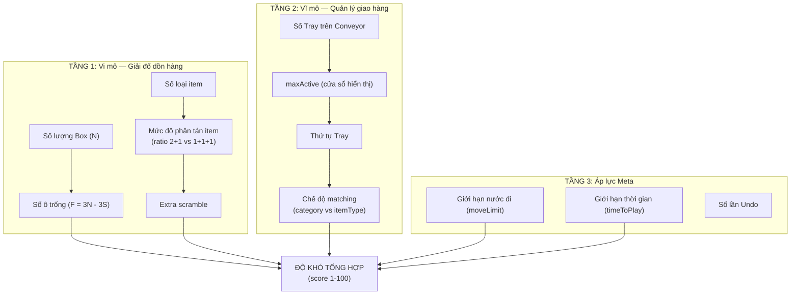

# Phân Tích Chi Tiết: Thuật Toán Sinh Level & Điều Chỉnh Độ Khó cho Factory Sort

> [!NOTE]
> Tài liệu này dựa hoàn toàn trên **Prototype thực tế** (source code trong `src/`), **SolvableLevelGenerator.js**, và **Solver.js** gốc. Mọi thuật ngữ đều được quy chiếu về code đang chạy.

---

## MỤC LỤC

1. [Mô Hình Trạng Thái Game](#1-mô-hình-trạng-thái-game)
2. [Các Thành Phần Ảnh Hưởng Độ Khó](#2-các-thành-phần-ảnh-hưởng-độ-khó)
3. [Tầng 1: Không Gian Thùng (Box Layer)](#3-tầng-1-không-gian-thùng-box-layer)
4. [Tầng 2: Hệ Thống Tray & Conveyor](#4-tầng-2-hệ-thống-tray--conveyor)
5. [Tầng 3: Sự Tương Tác Giữa 2 Tầng](#5-tầng-3-sự-tương-tác-giữa-2-tầng)
6. [Thuật Toán Sinh Level: Reverse Generation](#6-thuật-toán-sinh-level-reverse-generation)
7. [Bảng Tham Số Đầy Đủ & Cách Dùng](#7-bảng-tham-số-đầy-đủ--cách-dùng)
8. [Công Thức Tính Điểm Độ Khó](#8-công-thức-tính-điểm-độ-khó)
9. [Lưu Ý Kỹ Thuật Quan Trọng Khi Viết Solver](#9-lưu-ý-kỹ-thuật-quan-trọng-khi-viết-solver)
10. [Bảng Preset Mẫu & Lộ Trình Level](#10-bảng-preset-mẫu--lộ-trình-level)
11. [So Sánh Algorithm.md vs Prototype Thực Tế](#11-so-sánh-algorithmmd-vs-prototype-thực-tế)

---

## 1. Mô Hình Trạng Thái Game

Trạng thái game tại bất kỳ thời điểm nào được biểu diễn bằng:

```
State = {
  boxes:    Array<Box>,      // N thùng, mỗi thùng chứa 0-3 item
  conveyor: Array<Tray>,     // M tray xoay trên băng chuyền  
  wrapped:  Set<boxIndex>,   // các thùng đã wrapped (khóa cứng)
}
```

### Các bất biến cốt lõi (Invariants)

| Bất biến | Mô tả | Source code |
|----------|-------|-------------|
| **Sức chứa cố định** | Mỗi Box luôn chứa tối đa `maxSize = 3` item | [Box.js:8](file:///d:/Xuong_code/Idea-Game-Prototype/Factory%20Sort/src/core/Box.js#L8) |
| **Không ràng buộc loại** | `canAccept()` chỉ kiểm tra `items.length < 3 && !isWrapped` | [Box.js:27-29](file:///d:/Xuong_code/Idea-Game-Prototype/Factory%20Sort/src/core/Box.js#L27-L29) |
| **Grid mở** | Có thể lấy BẤT KỲ item nào bằng `splice(index, 1)` | [Box.js:11-17](file:///d:/Xuong_code/Idea-Game-Prototype/Factory%20Sort/src/core/Box.js#L11-L17) |
| **Tổng ô trống bất biến** | F = 3N − 3S (N = tổng box, S = số bộ 3 item). Mỗi nước đi chỉ dời 1 item, không tạo thêm hoặc mất ô trống. F không đổi suốt ván chơi cho đến khi wrap xảy ra | [Solver.js:288-294](file:///d:/Xuong_code/Idea-Game-Prototype/Factory%20Sort/Solver.js#L288-L294) |
| **Tray 1 slot** | Mỗi Tray chỉ nhận 1 Box wrapped, sau đó exit ngay | [Tray.js:6](file:///d:/Xuong_code/Idea-Game-Prototype/Factory%20Sort/src/core/Tray.js#L6) |
| **Tray match bằng Category** | `tray.canAccept(box)` kiểm tra `box.getCategory() === this.categoryId` | [Tray.js:9-12](file:///d:/Xuong_code/Idea-Game-Prototype/Factory%20Sort/src/core/Tray.js#L9-L12) |

### Định lý giải được (Solvability Theorem)

> [!IMPORTANT]
> **Nếu F ≥ 3 (tức có ít nhất 1 Thùng rỗng hoàn toàn), bàn chơi LUÔN giải được trong ≤ 4S nước đi.**
> 
> Chứng minh constructive trong [Solver.js:284-320](file:///d:/Xuong_code/Idea-Game-Prototype/Factory%20Sort/Solver.js#L284-L320). Hệ quả: **Không cần solver để verify solvability** — chỉ cần đảm bảo `numEmptyBoxes ≥ 1`.

---

## 2. Các Thành Phần Ảnh Hưởng Độ Khó

Độ khó của game được tạo bởi **HAI TẦNG QUYẾT ĐỊNH** hoạt động song song:



---

## 3. Tầng 1: Không Gian Thùng (Box Layer)

### 3.1 Tổng số Thùng (`numBoxes`)

| Tham số | Ý nghĩa | Phạm vi | Ảnh hưởng |
|---------|---------|---------|-----------|
| `numBoxes` | Tổng số Thùng trên bàn chơi | 4 → 10 | Tăng = nhiều thùng hơn = không gian lớn hơn nhưng cũng nhiều item hơn |

**Công thức trong prototype hiện tại:**
```javascript
// UIManager.js:107
numBoxes = Math.min(6 + Math.floor(level / 3), 10)
```

**Công thức trong SolvableLevelGenerator:**
```javascript
// SolvableLevelGenerator.js:232
numBoxes = Math.min(4 + Math.floor(level / 3), 10)
```

> [!WARNING]
> Hai nơi dùng công thức khác nhau (bắt đầu từ 6 vs 4). Cần đồng bộ khi tích hợp.

### 3.2 Số ô trống (`freeSlots` / `numEmptyBoxes`)

Đây là **lever độ khó QUAN TRỌNG NHẤT** ở tầng Box.

```
F (free slots) = 3 × numBoxes − 3 × numSets
               = 3 × (numBoxes − numSets)
               = 3 × numEmptyBoxes  (khi compactFreeSlots = true)
```

| `numEmptyBoxes` | F (ô trống) | Cảm nhận |
|-----------------|-------------|----------|
| 1 | 3 | **Tối thiểu** — Chỉ vừa đủ để xoay sở. Mỗi nước đi sai đều đau |
| 2 | 6 | Thoải mái hơn, dễ undo bằng tay |
| 3+ | 9+ | Rất dễ, gần như không thể thua |

**Chi tiết kỹ thuật — `compactFreeSlots`:**

Tham số này quyết định cách phân bổ ô trống:
- `compactFreeSlots = true` (mặc định): Dồn **TẤT CẢ** ô trống vào đúng `numEmptyBoxes` box rỗng. Các box có item đều **ĐẦY cả 3 ô**. → Rất CHẬT, khó.
- `compactFreeSlots = false`: Cho phép ô trống rải rác trong các box (có box chỉ chứa 1-2 item). → THOÁNG, dễ hơn nhiều.

```javascript
// SolvableLevelGenerator.js:124-127
compactFreeSlots: true,  // true => dồn hết ô trống vào empty boxes (chật, khó)
                         // false => để ô trống rải rác (thoáng, dễ)
```

> [!TIP]
> **Gợi ý thiết kế:** Dùng `compactFreeSlots: false` cho tutorial và level đầu (dưới level 6), chuyển sang `true` từ level 7 trở đi.

### 3.3 Số Category (`numCategories`)

| Tham số | Phạm vi | Catalog hiện tại |
|---------|---------|-----------------|
| `numCategories` | 1 → 4 | `stuffed_animals`, `food`, `stationery`, `sports` |

Category ảnh hưởng chủ yếu đến **tầng 2 (Tray matching)**, không trực tiếp đến bài toán dồn hàng. Tuy nhiên, nhiều category = nhiều **nhiễu thị giác** — người chơi khó phân biệt.

### 3.4 Số Item Type mỗi Category (`itemTypesPerCategory`)

| Tham số | Phạm vi | Catalog hiện tại |
|---------|---------|-----------------|
| `itemTypesPerCategory` | 1 → 3 | Mỗi category có 3 item types (VD: 🧸🦆🐰) |

**Ảnh hưởng kép:**
1. **Pool size** = `numCategories × itemTypesPerCategory`. Pool lớn → nhiều loại item trên bàn → khó nhận diện và quy hoạch hơn.
2. **Category confusion** = `typesUsed / catsUsed`. Nhiều type/cat → cùng 1 category có nhiều thùng trông khác nhau → dễ nhầm khi kéo vào Tray.

### 3.5 Mức độ phân tán item (`ratio21`)

> [!IMPORTANT]
> **Đây là tham số ẩn tinh tế nhất** — nó quyết định mỗi bộ 3 item bị xé lẻ như thế nào khi sinh level.

| Kiểu phân bổ | Mô tả | Ảnh hưởng |
|--------------|-------|-----------|
| **2+1** | 2 item cùng bộ nằm chung 1 box, 1 item nằm box khác | DỄ — chỉ cần 1-2 nước để gom đủ bộ |
| **1+1+1** | 3 item nằm ở 3 box hoàn toàn khác nhau | KHÓ — cần ≥3 nước và phải dọn rác trước |

```
ratio21 = 1.0  → 100% kiểu 2+1 → DỄ NHẤT
ratio21 = 0.6  → 60% kiểu 2+1, 40% kiểu 1+1+1 → TRUNG BÌNH (dữ liệu từ 4501 level)
ratio21 = 0.0  → 100% kiểu 1+1+1 → KHÓ NHẤT
```

**Số liệu thực tế từ SolvableLevelGenerator:**
```javascript
// SolvableLevelGenerator.js:113-116
ratio21: 0.6,  // Phân tích từ 4501 level: 60.3% 2+1, 39.7% 1+1+1
```

**Ảnh hưởng đến số nước đi tối thiểu (h):**
- Bộ kiểu 2+1: cần tối thiểu **1 nước** (dọn ô trống) + 1 nước (kéo item lẻ về) = **~2 nước**
- Bộ kiểu 1+1+1: cần tối thiểu **2 nước dọn** + 2 nước kéo = **~4 nước**

### 3.6 Scramble bổ sung (`extraScramble`)

Sau khi scramble cơ bản (dựa trên ratio21), có thể áp dụng thêm K nước đi ngược bổ sung để làm bàn cờ "bẩn" hơn.

```javascript
// SolvableLevelGenerator.js:119-121
extraScramble: 0.0,  // 0 = không thêm. 2.0 = thêm gấp đôi số nước đi cơ bản.
```

| `extraScramble` | Hiệu ứng |
|-----------------|-----------|
| 0.0 | Không có. Bàn cờ "sạch" — lời giải rõ ràng |
| 0.5 | Thêm 50% nước đi ngược → bàn cờ hơi rối |
| 1.0 | Gấp đôi → bàn cờ rối bời, phải đi đường vòng |
| 2.0 | Tối đa — ban cờ cực kỳ lộn xộn |

> [!TIP]
> `extraScramble` KHÔNG tăng `minMoves` tối ưu (vì cận dưới h không đổi), nhưng **tăng số nước đi thực tế** vì người chơi phải "giải rối" trước khi tìm đường đi thẳng.

### 3.7 Số bộ tối đa mỗi loại item (`maxSetsPerType`)

```javascript
// SolvableLevelGenerator.js:110
maxSetsPerType: 3,  // 1 loại item có thể chiếm tối đa 3 bộ (= 3 Tray cùng loại)
```

| `maxSetsPerType` | Ảnh hưởng |
|------------------|-----------|
| 1 | Mỗi loại item chỉ xuất hiện 1 bộ (3 cái). Đa dạng tối đa |
| 2-3 | 1 loại item có thể xuất hiện 6-9 cái → DỄ HƠN (dễ "nhặt nhầm" cùng loại → vẫn đúng) |

---

## 4. Tầng 2: Hệ Thống Tray & Conveyor

### 4.1 Tổng số Tray (`numSets`)

```
numTrays = numSets = numBoxes - numEmptyBoxes (mặc định)
```

Mỗi Tray match đúng 1 bộ 3 item. Số Tray = Số bộ item = Số Box có item ban đầu.

### 4.2 Cửa sổ hiển thị (`conveyorMaxActive`)

```javascript
// SolvableLevelGenerator.js:131
conveyorMaxActive: 4,  // Số Tray hiển thị cùng lúc trên Oval
```

Đây là **TRỌNG SỐ CỰC KỲ QUAN TRỌNG** cho tầng 2:

| Tình huống | Ảnh hưởng |
|------------|-----------|
| `maxActive ≥ numTrays` | TẤT CẢ Tray đều hiển thị → Người chơi luôn có thể giao bất kỳ box wrapped nào → **RẤT DỄ** |
| `maxActive < numTrays` | Một số Tray bị ẩn bên trong Conveyor → Người chơi phải **ưu tiên giao cho Tray đang hiện** trước khi nó quay đi → **KHÓ HƠN** |
| `maxActive = 1` | Cực khó — chỉ 1 Tray hiển thị, phải giao đúng thứ tự |

> [!IMPORTANT]
> **Trong prototype hiện tại**, Tray chạy vòng Oval liên tục (không biến mất), nên dù `maxActive < numTrays`, người chơi vẫn có thể **chờ** Tray quay lại. Tuy nhiên, thời gian chờ tạo áp lực gián tiếp nếu kết hợp với `timeToPlay`.

### 4.3 Thứ tự Tray trên băng chuyền (`trayOrder`)

| Giá trị | Mô tả | Độ khó |
|---------|-------|--------|
| `'wrapOrder'` | Tray sắp theo thứ tự mà lời giải tham chiếu wrap các Box | **DỄ** — Tray đúng luôn sẵn sàng khi cần |
| `'shuffled'` | Tray xáo trộn ngẫu nhiên | **TRUNG BÌNH** — Có khi phải chờ |
| `'reverse'` | Tray sắp theo thứ tự NGƯỢC lời giải | **KHÓ** — Box wrapped đầu tiên phải chờ lâu nhất |

```javascript
// SolvableLevelGenerator.js:243
trayOrder = level < 8 ? 'wrapOrder' : level < 20 ? 'shuffled' : 'reverse';
```

**Chỉ số `maxWrappedHeld`:** Đo lường số Box wrapped mà người chơi phải **GIỮ LẠI** trên bàn cùng lúc vì chưa có Tray phù hợp. Giá trị cao = tệ vì:
1. Box wrapped chiếm chỗ trên bàn nhưng không thể tương tác.
2. Giảm không gian xoay xở cho bài toán dồn hàng.

### 4.4 Chế độ matching (`trayMatchMode`)

| Giá trị | Logic matching | Độ khó |
|---------|---------------|--------|
| `'category'` | Box chỉ cần thuộc đúng **category** (VD: 🧸 vào Tray "Thú nhồi bông") | **DỄ** — Nhiều Box có thể vào cùng 1 dạng Tray |
| `'itemType'` | Box phải match đúng **loại item cụ thể** (VD: 🧸🧸🧸 chỉ vào Tray "🧸") | **KHÓ** — Phải giao chính xác |

```javascript
// SolvableLevelGenerator.js:246
trayMatchMode = level >= 40 ? 'itemType' : 'category';
```

> [!NOTE]
> Trong prototype (`Tray.js`), code hiện tại chỉ implement mode `'category'`: `box.getCategory() === this.categoryId`. Mode `'itemType'` chưa được implement trong `Tray.canAccept()` nhưng đã được thiết kế sẵn trong `SolvableLevelGenerator.js`.

### 4.5 Kiểu Conveyor

| Kiểu | Mô tả | Trạng thái |
|------|-------|------------|
| **Oval** | Tray xoay liên tục trên ellipse. Tốc độ cố định `-0.015 rad/frame`. Không bao giờ biến mất cho đến khi nhận hàng | ✅ ĐÃ IMPLEMENT |
| **One-way** | Hàng Tray xếp dọc, chỉ Tray đầu hàng mới nhận box, xong thì hàng dịch lên | ❌ CHƯA IMPLEMENT |

**Tham số kỹ thuật của Oval Conveyor:**
```javascript
// TrayRenderer.js:114, 147-148
deltaTheta = -0.015 * (dt / 16.66)  // tốc độ xoay (rad/frame)
rx = (containerWidth - 90) / 2       // bán kính ngang ellipse
ry = 80                               // bán kính dọc ellipse
```

---

## 5. Tầng 3: Sự Tương Tác Giữa 2 Tầng

### 5.1 Deadlock phức hợp (Cross-layer deadlock)

Trong prototype hiện tại, **KHÔNG THỂ** xảy ra deadlock thuần túy ở tầng Tray (vì Tray xoay vòng mãi). Tuy nhiên, trong tương lai nếu implement One-way Conveyor hoặc Tray có thời hạn, thì có thể xảy ra deadlock phức hợp:

```
Deadlock phức hợp xảy ra khi:
1. Bàn chơi hết ô trống (không thể dồn hàng nữa)
   VÀ
2. Các Box wrapped đang chiếm hết chỗ nhưng không có Tray phù hợp
```

### 5.2 Hiệu ứng "Tắc nghẽn" (Backlog effect)

Khi `trayOrder = 'reverse'` hoặc `'shuffled'`, người chơi có thể hoàn thành Box nhưng không giao được ngay → Box wrapped **chiếm chỗ trên bàn** → giảm không gian → khó dồn hàng tiếp.

**Chỉ số đo lường:** `maxWrappedHeld` (xem mục 4.3)

### 5.3 Chiến lược "Ưu tiên Tray đang hiện"

Người chơi giỏi sẽ:
1. Nhìn Conveyor trước để biết Tray nào đang hiện.
2. Ưu tiên hoàn thành bộ item mà Tray đang sẵn sàng.
3. Giao ngay để giải phóng chỗ.

→ Tầng 2 tạo ra **thứ tự ưu tiên** cho bài toán dồn hàng ở tầng 1.

---

## 6. Thuật Toán Sinh Level: Reverse Generation

### 6.1 Nguyên lý

Thay vì sinh bàn cờ ngẫu nhiên rồi verify bằng solver (chi phí O(b^d), freeze UI), ta **xây ngược từ trạng thái thắng**:

```mermaid
flowchart LR
    S0["S₀: Trạng thái THẮNG<br/>Mỗi box = 3 item cùng loại<br/>+ E box rỗng"] 
    -->|"K nước đi ngược<br/>(scramble)"| 
    SK["Sₖ: Trạng thái xuất phát<br/>(= level cho người chơi)"]
    
    SK -->|"Đảo ngược K nước<br/>(= lời giải forward)"| S0
```

**Chi phí:** O(K) thay vì O(b^d). **Solvability là BẤT BIẾN CỦA CẤU TRÚC**.

### 6.2 Bất biến an toàn (Safety Invariant)

> [!CAUTION]
> **Cực kỳ quan trọng:** Trong khi scramble ngược, nếu vô tình tạo ra box 3 item cùng loại (ngoài các box "pristine" chưa bị động), thì khi replay forward, box đó sẽ **wrapped sớm** → chặn nước đi tiếp theo → level không giải được.

```javascript
// SolvableLevelGenerator.js:363-369
function tryReverse(from, index, to) {
    // Nguồn: nếu là box 3-cùng-loại NHƯNG không pristine → đã wrapped → không lấy ra được
    if (!pristine[from] && isWrapped(boxes[from], cap)) return false;
    // Đích: sau khi nhận item không được thành 3-cùng-loại
    const after = boxes[to].concat([item]);
    if (after.length === cap && after.every(x => x === after[0])) return false;
}
```

### 6.3 Các bước chi tiết

```
Bước 1: Tạo trạng thái THẮNG
   → S box = [AAA], [BBB], [CCC], ... + E box = []

Bước 2: Chọn phân bổ cho mỗi bộ (2+1 hoặc 1+1+1 theo ratio21)
   → Tính số nước đi ngược cần thiết: d=2 → 1 nước, d=3 → 2 nước

Bước 3: Xáo trộn cơ bản (scramble)
   → Kéo item ra khỏi box "nhà", đẩy sang box khác
   → Kiểm tra bất biến an toàn sau MỖI nước

Bước 4: Scramble bổ sung (extraScramble × K nước thêm)

Bước 5: Compaction (dồn ô trống)
   → compactFreeSlots=true: đẩy hết ô trống vào đúng numEmptyBoxes box
   → compactFreeSlots=false: giữ ô trống rải rác

Bước 6: Verify trạng thái xuất phát
   → Không có box wrapped sẵn
   → Có đủ numEmptyBoxes box rỗng

Bước 7: Tạo lời giải forward = đảo ngược danh sách nước đi
```

---

## 7. Bảng Tham Số Đầy Đủ & Cách Dùng

### 7.1 Tham số Quy mô bàn chơi

| Tham số | Mặc định | Phạm vi | Ảnh hưởng lên độ khó |
|---------|----------|---------|---------------------|
| `numBoxes` | 6 | 4-10 | ↑ = Nhiều box hơn, phức tạp hơn |
| `boxCapacity` | 3 | Cố định | Không thay đổi (GDD quy định) |
| `numEmptyBoxes` | 1 | ≥1 | ↑ = Nhiều ô trống, DỄ hơn |
| `numSets` | `numBoxes - numEmptyBoxes` | 1 → numBoxes-1 | ↑ = Nhiều bộ, PHỨC TẠP hơn |

### 7.2 Tham số Item Pool

| Tham số | Mặc định | Phạm vi | Ảnh hưởng |
|---------|----------|---------|-----------|
| `numCategories` | 2 | 1-4 | ↑ = Nhiều màu, nhiều "nhiễu thị giác" |
| `itemTypesPerCategory` | 2 | 1-3 | ↑ = Pool size lớn hơn |
| `maxSetsPerType` | 3 | 1-∞ | ↑ = 1 loại lặp nhiều (DỄ hơn vì dồn nhầm vẫn đúng) |

### 7.3 Tham số Độ khó (Dồn hàng)

| Tham số | Mặc định | Phạm vi | Ảnh hưởng |
|---------|----------|---------|-----------|
| `ratio21` | 0.6 | 0.0-1.0 | ↑ = DỄ (nhiều bộ 2+1) |
| `extraScramble` | 0.0 | 0.0-2.0 | ↑ = KHÓ (bàn cờ rối hơn) |
| `compactFreeSlots` | true | boolean | true = CHẬT, false = THOÁNG |

### 7.4 Tham số Tray/Conveyor

| Tham số | Mặc định | Các giá trị | Ảnh hưởng |
|---------|----------|-------------|-----------|
| `trayMatchMode` | `'category'` | `'category'`, `'itemType'` | `itemType` = KHÓ hơn nhiều |
| `trayOrder` | `'wrapOrder'` | `'wrapOrder'`, `'shuffled'`, `'reverse'` | `reverse` = KHÓ nhất |
| `conveyorMaxActive` | 4 | 1-∞ | ↓ = KHÓ (ít Tray hiện) |
| `conveyorType` | `'oval'` | `'oval'` | Chỉ có oval hiện tại |

### 7.5 Tham số Áp lực Meta

| Tham số | Mặc định | Ví dụ | Ảnh hưởng |
|---------|----------|-------|-----------|
| `moveLimitSlack` | `null` (không giới hạn) | 1.6 (dễ) → 1.05 (khó) | moveLimit = refMoves × slack |
| `secondsPerMove` | `null` (không giới hạn) | 6 (dễ) → 3.5 (khó) | timeToPlay = refMoves × secs + 20 |
| `undoCount` | 3 | 0-∞ | ↓ = KHÓ (ít cơ hội sửa sai) |

---

## 8. Công Thức Tính Điểm Độ Khó

Score từ 1 đến 100, gồm 5 thành phần trọng số:

```javascript
// SolvableLevelGenerator.js:580-593
nm = min(refMoves / 40, 1)                           // Khối lượng nước đi
np = min(refMoves / max(1, freeSlots) / 12, 1)       // Áp lực ô trống
nx = mixedBoxRatio                                    // Độ đan xen (bao nhiêu box trộn nhiều loại)
nc = min(categoryConfusion / 3, 1)                    // Nhiễu thị giác
nw = min(maxWrappedHeld / 4, 1)                       // Sức ép tắc nghẽn Tray

score = clamp(100 × (0.38·nm + 0.27·np + 0.15·nx + 0.10·nc + 0.10·nw), 1, 100)
```

| Thành phần | Trọng số | Ý nghĩa |
|------------|---------|---------|
| **Volume** (nm) | **38%** | Tổng khối lượng công việc (số nước đi tham chiếu) |
| **Pressure** (np) | **27%** | Mật độ nước đi trên mỗi ô trống — phản ánh "độ chật" |
| **Interleave** (nx) | **15%** | Tỉ lệ box có nhiều loại item lẫn lộn (đo mức "bẩn" của bàn cờ) |
| **Confusion** (nc) | **10%** | Số loại item / số category — nhiễu thị giác |
| **Tray Backlog** (nw) | **10%** | Số box wrapped phải giữ lại cùng lúc |

> [!NOTE]
> Trọng số trên là **GIẢ THUYẾT THIẾT KẾ**, cần hiệu chỉnh lại sau khi có telemetry thật từ người chơi. Xem [SolvableLevelGenerator.js:578-593](file:///d:/Xuong_code/Idea-Game-Prototype/Factory%20Sort/SolvableLevelGenerator.js#L578-L593).

---

## 9. Lưu Ý Kỹ Thuật Quan Trọng Khi Viết Solver

### 9.1 Branching Factor cực lớn

Do **không ràng buộc loại item** + **Grid mở** (lấy bất kỳ item), branching factor ở mỗi state là:

```
b = Σ (số item trong box i) × (số box j ≠ i có ô trống)
```

Ví dụ: 6 box, 5 đầy (3 item), 1 rỗng → b = 5×3×1 = 15 (nhỏ). Nhưng nếu có nhiều box chưa đầy: 6 box, mỗi box 2 item → b = 6×2×5 = 60 → **BFS chết**.

### 9.2 Các chiến lược Pruning đã được implement

Xem [Solver.js:200-239](file:///d:/Xuong_code/Idea-Game-Prototype/Factory%20Sort/Solver.js#L200-L239):

| Pruning | Mô tả | Hiệu quả |
|---------|-------|-----------|
| **Skip wrapped** | Không lấy item từ box đã wrapped | Giảm b đáng kể |
| **Dedup item type** | Trong 1 box, mỗi loại item chỉ thử 1 lần (các bản sao tương đương) | Giảm b ~50% |
| **Dedup empty target** | Các box rỗng tương đương nhau, chỉ thử 1 cái | Giảm b thêm |
| **State dedup** | Sort box trước khi hash (hoán vị box = cùng state) | Giảm visited set rất nhiều |

### 9.3 Heuristic Admissible cho IDA*

```javascript
// Solver.js:102-123
h(state) = Σ_type ( numBoxes chứa type − ceil(count(type)/3) )
```

**Chứng minh admissible:** Mỗi nước đi dời 1 item → chỉ giảm "numBoxes chứa type t" của đúng 1 loại t tối đa 1 → h giảm tối đa 1 mỗi bước → h ≤ cost thật.

### 9.4 Solver Constructive (O(S)) — Dùng làm Hint System

[Solver.js:321-396](file:///d:/Xuong_code/Idea-Game-Prototype/Factory%20Sort/Solver.js#L321-L396) implement giải constructive:
1. Chọn loại t, chọn Box X giữ nhiều bản sao t nhất
2. "Dọn nhà" X: đẩy item khác loại ra
3. "Gom" bản sao t về X → wrapped
4. Lặp lại

**Ưu điểm:** O(S), không bao giờ freeze UI. **Nhược điểm:** Không tối ưu (lời giải dài hơn IDA* 20-80%).

### 9.5 Tray Delivery Simulation

[SolvableLevelGenerator.js:637-686](file:///d:/Xuong_code/Idea-Game-Prototype/Factory%20Sort/SolvableLevelGenerator.js#L637-L686): Mô phỏng việc giao hàng để tính `maxWrappedHeld`. Logic:
- Chạy lời giải tham chiếu
- Mỗi khi box wrap xong → thử giao cho Tray trong cửa sổ `maxActive`
- Nếu không có Tray phù hợp → giữ lại, đếm backlog

---

## 10. Bảng Preset Mẫu & Lộ Trình Level

### 10.1 Preset có sẵn

| Preset | Box | Rỗng | Bộ | Cat | Type/Cat | ratio21 | Đặc trưng |
|--------|-----|------|-----|-----|----------|---------|-----------|
| `tutorial` | 4 | 1 | 2 | 1 | 2 | 1.0 | Rất dễ, compact=false |
| `easy` | 6 | 1 | 4 | 2 | 2 | 0.85 | Dễ, moveLimit slack 1.8 |
| `normal` | 7 | 1 | auto | 3 | 2 | 0.60 | Chuẩn, slack 1.5 |
| `hard` | 9 | 1 | auto | 3 | 3 | 0.35 | Khó, scramble 0.5, tray shuffled |
| `expert` | 10 | 1 | auto | 4 | 3 | 0.10 | Cực khó, scramble 1.0, tray reverse, time limit |

### 10.2 Lộ trình theo Level Number

```javascript
// SolvableLevelGenerator.js:231-263
Level  1: 4 box, 1 cat, ratio21=0.96, trayOrder=wrapOrder, no limits
Level  5: 5 box, 2 cat, ratio21=0.78, trayOrder=wrapOrder, moveLimit 1.88x
Level 10: 7 box, 3 cat, ratio21=0.55, trayOrder=shuffled,  moveLimit 1.75x
Level 20: 10 box, 4 cat, ratio21=0.10, trayOrder=shuffled,  moveLimit 1.50x
Level 30: 10 box, 4 cat, ratio21=0.15, trayOrder=reverse,   moveLimit 1.25x, extra=0.9
Level 45: 10 box, 4 cat, ratio21=0.15, trayOrder=reverse,   moveLimit 1.05x, time 6.0s/move, match=itemType
```

---

## 11. So Sánh Algorithm.md vs Prototype Thực Tế

> [!CAUTION]
> **`Algorithm.md` MÔ TẢ MỘT GAME HOÀN TOÀN KHÁC** so với Prototype. Dưới đây là bảng so sánh:

| Khía cạnh | Algorithm.md | Prototype thực tế |
|-----------|-------------|-------------------|
| **Layout** | Grid 2D với `posX/posY`, nhiều cell types (0,1,2,3) | Flat grid, 1 loại Box duy nhất |
| **Layers** | Mỗi cell có **nhiều layer chồng lên nhau** (`itemsLayer[]`), tối đa 10 layer | **KHÔNG CÓ layer**. Mỗi Box = 1 mảng items phẳng |
| **Cell types** | `cellType=0` (main), `cellType=1` (conveyor), `cellType=2` (tray), `cellType=3` (alt conveyor) | Chỉ có Box (= thùng) + Tray (= khay) |
| **Move types** | `moveType: 0-5` (static, feeder, various conveyors) | Không có move types. Box đứng yên |
| **Feeder** | Có feeder columns đẩy item vào | Không có feeder |
| **Items per slot** | Mỗi layer có 3 slots, mỗi slot 1 item | Mỗi Box có 3 slots |
| **Slot per cell** | Tray cell: 1 slot/layer | Tray: 1 slot duy nhất |
| **Lock** | Cell có thể bị lock (`isLock=1`) | Không có lock |
| **Wildcard** | Có item `id=-1` (wildcard) | Không có wildcard |
| **Sinh level** | Forward: tạo grid → tính slots → fill random | **Reverse**: xây ngược từ trạng thái thắng |
| **Verify** | Không có solver verify | Có `simulate()` + `solveIDA()` + `solveConstructive()` |

**Kết luận:** `Algorithm.md` phải được viết lại hoàn toàn hoặc bỏ đi nếu mục tiêu là match với Prototype hiện tại.

---

## Tóm tắt: Checklist khi viết Level Generator

- [ ] Đảm bảo `numEmptyBoxes ≥ 1` (luật cứng)
- [ ] Mỗi loại item xuất hiện đúng bội số của 3
- [ ] Trạng thái xuất phát KHÔNG có box wrapped sẵn
- [ ] Trạng thái xuất phát KHÔNG ở trạng thái THUA (mọi box đầy)
- [ ] Lời giải tham chiếu replay thành công qua `simulate()`
- [ ] Số Tray = Số bộ item = `numSets`
- [ ] Tính `maxWrappedHeld` để đánh giá áp lực Tray
- [ ] Tính điểm độ khó từ 5 thành phần
- [ ] Nếu level nhỏ (≤8 box, ≤16 moves): chạy IDA* gắn nhãn `optimalMoves`
